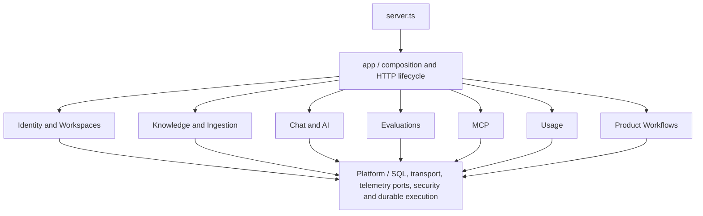

# Backend module guide

Lumora is a TypeScript modular monolith. Business capabilities are grouped under
`apps/api/src/modules`, using feature-module organization inspired by NestJS and
the existing Fastify plugin/composition model. The application root wires the
providers explicitly. See [ADR 0002](decisions/0002-business-modules.md) for the
decision and trade-offs.

## Where to find a capability

| Module | Responsibility |
| --- | --- |
| `identity` | Session verification, bounded Supabase Auth access and member-directory lookup |
| `workspaces` | Workspace creation, memberships, roles, onboarding and invitations |
| `knowledge` | Document library, original-file access, passage storage, retrieval and demo libraries |
| `ingestion` | Upload admission, text extraction, OCR, language/structure enrichment and indexing jobs |
| `chat` | Grounded answers, model selection, conversations, feedback, streaming and semantic cache |
| `ai` | Provider ports/adapters, embedding versions, rerankers, prompt/output and cost guard policies |
| `evaluations` | Golden sets, injection checks, reviewed replays, judges and versioned reports |
| `mcp` | Scoped read tools, OAuth transport and the authorized-action boundary |
| `usage` | User/workspace quotas, usage ledger, administrative audit and budget deliveries |
| `workflows` | Authorized product execution and approval orchestration across capabilities |



The diagram groups capabilities for orientation; it does not claim the modules
are independent microservices. They share the existing database and process.
Tenant authorization, SQL transaction/fencing rules and provider budgets remain
code-enforced boundaries within that deployment.

## Inside a module

```text
modules/ingestion/
  ingestion.module.ts
  ingestion.controller.ts
  index.ts
  application/
    ports/
    use-cases/
  infrastructure/
    extraction/
    langgraph/
    postgres/
```

- **Module factory:** assembles concrete providers using explicit configuration
  and injected resources. It does not create a second pool or hide a timer.
- **Controller:** a small Fastify adapter responsible for input validation,
  authorization and HTTP responses. It calls injected capabilities.
- **Application service/use case:** implements one operation using ports and
  policy. Existing use-case classes already provide this role.
- **Port:** defines the behavior needed from a repository, provider or service.
  Domain records and HTTP DTOs remain separate where their semantics differ.
- **Infrastructure:** PostgreSQL, Supabase, provider SDK, LangGraph or extraction
  adapters implementing those responsibilities.
- **Public API:** named contracts and capabilities exported from `index.ts` for
  other modules. Composition files and controllers stay outside that barrel.

Create only the folders a feature needs. Pure policy belongs beside its feature;
do not introduce a controller/service/repository trio for a trivial function.

## Shared platform and application root

`platform` owns reusable SQL deadlines/transactions, external HTTP transport,
correlation/event ports, redaction/risk primitives, generic durable execution,
workflow encryption, retry policy and bounded process shutdown. It must not load
business module implementations at runtime. The two reviewed type-only workspace
authorization contracts are checked as explicit edges.

`app` owns overall composition, the HTTP dependency facade, cross-cutting HTTP
hooks, exception mapping and telemetry transport that classifies product errors.
Application composition may bind concrete module adapters. Runtime resources have
one owner and repeated shutdown requests share one promise. See the
[shutdown runbook](operations/server-shutdown.md).

`server.ts`, operational commands under `interfaces/cli` and the restricted MCP
stdio launcher retain their existing entry paths. `config.ts` validates the
environment; SQL migration files stay under `apps/api/db/migrations`.

## Rules for changes

1. Start with the business module that owns the behavior.
2. Keep HTTP/vendor dependencies outside application/domain code.
3. Use another module's named public exports; use relative internal imports
   within a module. Inject the capability you need, rather than importing its
   composition factory from a service.
4. Keep shared HTTP schemas in `packages/contracts`. Decode external data before
   using it; folder boundaries do not validate an API response.
5. Preserve explicit workspace selection, fresh membership checks, quotas,
   durable IDs and atomic fenced transactions.
6. Add behavior-focused verification and update the
   [technical backlog](technical-backlog.md) with evidence.

```bash
npm run typecheck
npm run check:architecture
npm run test:architecture
npm test
npm run eval:harness
```

The [architecture gate](architecture-checks.md) checks frontend FSD, backend
module exports, inward dependencies and runtime cycles. PostgreSQL, responsive
browser tests and the Docker OCR smoke test remain separate release gates.
Passing dependency checks does not establish capacity or production scale;
mixed-workload measurement remains in the backlog.
