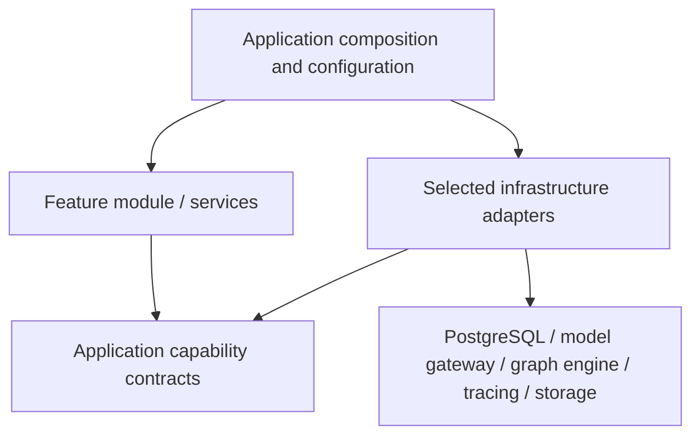

# ADR 0003: Technology-neutral feature assembly

- Date: 2026-11-07
- Status: accepted; implemented, validated and published under BE-15 at `cbd0f67`
- Baseline: `d0459492862a181d77860a1aa26a18e3385f1caa`

## Concrete problem

ADR 0002 groups features coherently, but its first delivery still constructs
vendor adapters inside several `*.module.ts` factories. Knowledge, Workspaces,
MCP and Usage accept `pg.Pool`; Chat creates PostgreSQL storage, LangGraph flows
and LangSmith wrapping; Evaluations and Workflows select PostgreSQL/LangGraph;
AI assembly selects provider SDKs directly. Some configuration types also expose
vendor environment names to feature assembly.

The owner explicitly requested replaceable database, provider, graph and tracing
tools. Directory grouping alone does not provide that property.

## Decision

Business module assembly depends on application capabilities and plain feature
options. `app/composition` chooses concrete adapters and injects them. Keep
existing feature-owned infrastructure adapters for locality; their vendor imports
are expected. Application/domain code and module factories must not import those
implementations, SDK types or global composition.

Relevant boundaries include:

| Need | Capability used by features | Current implementation selected outside core |
| --- | --- | --- |
| Documents, memberships, jobs, usage | Feature-specific repository/service ports | PostgreSQL adapters |
| Identity and original files | Identity/directory/file-store ports | Supabase SDK adapters |
| Generation, embedding, reranking, judging | Existing provider ports and a read-only factory registry | Ollama, OpenRouter, Bedrock and optional Jina |
| RAG/chat/ingestion/evaluation orchestration | Plain workflow/factory contracts and `WorkflowEngine` | Current LangGraph adapters and durable runtime |
| Tracing and operational events | Workflow decorator/observer capabilities | Optional LangSmith and OpenTelemetry adapters |
| Budget notifications | Budget service/outbox capabilities | Current PostgreSQL-backed signed webhook delivery |

Use domain operations, not a generic `query(sql)` facade or universal CRUD
repository. Prefer existing ports. Add an interface only for a demonstrated
capability boundary. A factory that merely returns its inputs is unnecessary;
feature factories assemble actual use cases/policies, while pure vendor bindings
belong in composition.

Provider registration is backend-owned. Features receive read-only capability
creation, not a mutable registry or browser-supplied SDK identifier. Preserve
current public model allowlists and persisted provider constraints in this
increment. A deliberately supported new provider requires adapter registration
and compatible configuration/contract activation, not a new vendor branch in
business policy.

Tracing receives an already-created workflow through a plain decorator. Workflow
contracts must not expose LangGraph saver/state types. Database ports must not
expose `Pool`, clients, SQL or PostgreSQL row types. Feature options describe
limits, model identities and policy; vendor URLs, secrets and environment field
names remain in outer configuration/bindings.

## Compatibility and tests

Retain current adapters and behavior. Preserve redaction, model allowlists,
embedding dimensions/revisions, cache identity, node/graph versions, quota
receipts, pricing provenance, budgets, approval, cancellation, lease fencing and
unknown-outcome handling. Keep one resource owner and existing public API shapes.

Use typed alternate in-memory/fake adapters to prove feature assembly works
without PostgreSQL, LangGraph, LangSmith or a provider SDK. Continue real
PostgreSQL, provider-mocked, graph/recovery, UX, evaluation and native OCR tests
for the actual configured adapters. Enforce the dependency boundary automatically
for both runtime and type-only imports.

An interface does not make incompatible tools interchangeable. A new database
must satisfy transactional/idempotency/isolation contracts and migrate data. A
new workflow runtime must address existing checkpoint compatibility. Changing
embedding identity still requires versioned reindexing and cache invalidation.
Providers must satisfy required output, usage, streaming and cancellation
capabilities. Do not silently drop a safety property to make an adapter fit.

No framework, ORM, DI container, hosted service or additional package is required
for this decision. It evolves the existing ports and explicit constructor/factory
injection rather than wrapping every language/library operation.

## Verification evidence

The [release record](../operations/release-2026-11-07-capability-boundaries.md)
tracks the seven-check harness, 78 architecture fixtures, two zero-violation
dependency graphs, replacement-adapter contracts, current-adapter HTTP/graph
coverage, 83 PostgreSQL checks, isolated embedding cutover and native OCR smoke.
The injected transaction writer is covered by report-insert rollback and lease-
expiry rollback cases. All four exact-source CI jobs and both live deployments
were verified on 2026-11-07; IDs and production checks are in that record.
