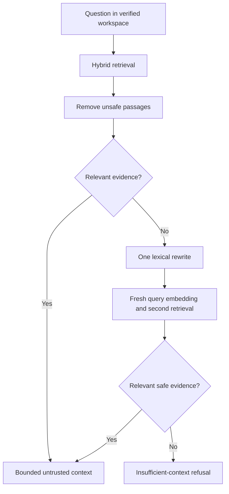
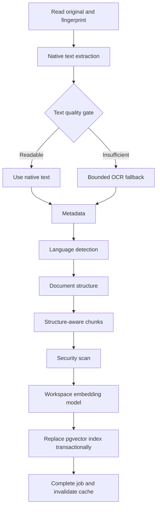
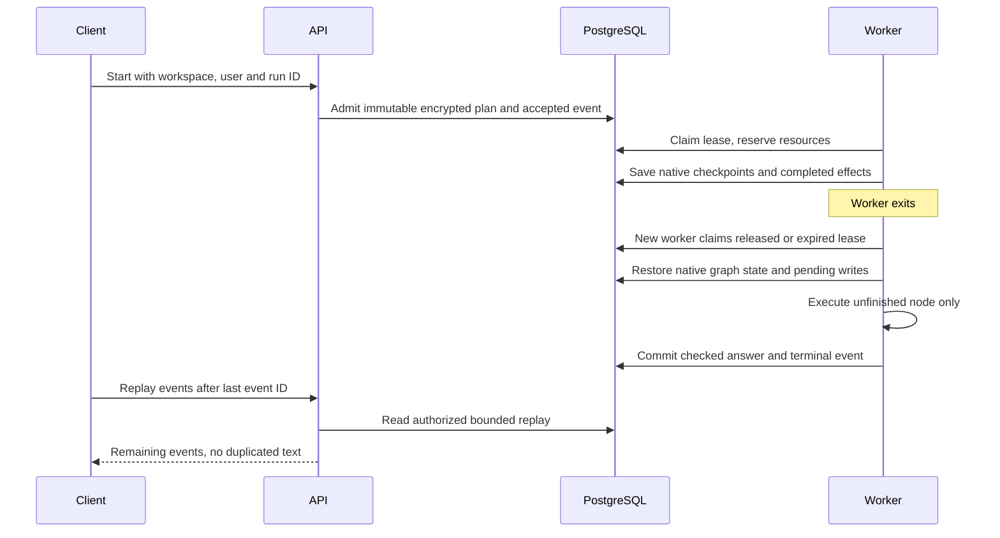

# Durable LangGraph workflows

## Scope and decisions

Lumora uses native LangGraph state graphs for RAG, document preparation, and
owner-triggered evaluations. When `WORKFLOWS_ENABLED=true`, authenticated chat
runs, queued ingestion, and dashboard evaluations use encrypted PostgreSQL
checkpoints. Saved JSON fallback requests use the same durable chat admission
as SSE. Anonymous chat, legacy JSON Q&A, comparisons, and direct CLI imports
remain bounded operations outside the native workflow runner. Saved comparisons
have a durable admission and result record; an uncertain in-flight comparison
is marked interrupted instead of silently repeated after a server restart. This is execution recovery with
24-hour retention. [Private conversation history](durable-conversations.md) has
a separate 90-day product lifecycle and links its saved messages to these executions.

The application layer owns authorization, admission, and budgets through ports.
The infrastructure layer implements LangGraph, the checkpoint saver, provider
adapters, and PostgreSQL transactions. Browser input cannot name a graph node,
checkpoint namespace, tool, provider model, filesystem path, or approval payload.

### What the model and code decide

| Decision | Owner |
| --- | --- |
| Draft an answer and cite supplied reference IDs | Allowlisted chat model |
| Assess support for exact answer claims | Selected model acting as evidence judge; never sole authorization authority |
| Tenant, membership, role, model allowlist, and embedding revision | Server code and database |
| Relevance threshold and one lexical retrieval rewrite | Server code |
| Maximum one answer repair, citation membership, exact evidence quotes, and claim coverage | Server code |
| Approval, cancellation, lease ownership, deadlines, and resource caps | Server code and atomic database predicates |
| Execute arbitrary tools, shell commands, or writes proposed in a document | Prohibited by these graphs |

## 1. Adaptive retrieval



The rewrite removes common English/Portuguese question prefixes and trailing
question marks, and is limited to 1,000 characters. It uses the question rather
than instructions from documents. Negations, names, and dates are preserved.
The second search does not reuse the original query vector. Both searches use
the same workspace and pinned embedding revision. There is no unbounded loop.
Similarity remains a retrieval signal, not a probability that an answer is true.

## 2. Evidence verification and repair

Generation produces structured JSON. Zod validates the shape; citation IDs must
belong to the exact bounded context. For OpenRouter in `RAG_CLAIM_MODE=model`,
the selected allowlisted chat model also assesses the redacted answer against
its cited passages. Comparisons and automatic routing use the verifier of the
actual selected model. The public evaluation judge is not reused on private
workspace content.

Code requires each claim to be an exact part of the answer, each evidence quote
to occur in a supplied passage, and all substantive answer text to be accounted
for. These checks catch invented references and omitted claims. They do not
prove semantic entailment: a judge can misread a valid quote. The extractive mode
requires complete answer sentences to occur in the cited text and uses no extra
judge request. Ollama and Bedrock currently use this conservative mode.

Invalid citations or unsupported claims take one repair edge. Trusted code
supplies the repair policy; the previous draft remains bounded untrusted data.
If verification still fails, Lumora returns a refusal and no answer text or
citations. Provider draft tokens are buffered. Validated text and citations are
published together; this sacrifices immediate raw-token display for consistency
and avoids exposing a draft that is subsequently rejected.

## 3. Checkpointed ingestion



Each node stores state and safe duration/count events. Native PDF pages survive
a later OCR failure. Retrying a failed job resumes its failed node; completed
provider results are reused through an encrypted effect journal. Original bytes
are reread through the stored job reference and checked against SHA-256 after
recovery. Original binaries are not copied into checkpoints.

Explicit reindexing creates a new ingestion job, with a new run and budget. A
retry retains the existing run, successful effects, and consumed budget. This
prevents reindex from accidentally returning the old completed checkpoint.
Cancellation stops active provider requests and OCR child processes and blocks
late index commits. It does not undo an index transaction already committed.

## 4. Unified evaluation graph

The graph runs approval (when generation/judging is requested), reference
retrieval, retrieval metrics, judge calibration, public answer generation,
faithfulness, reviewed-passage context precision, deterministic injection
screening, and report persistence. A failed calibration skips answer generation.
A report is idempotent per workflow and records graph/report version, commit,
model/prompt metadata, dataset identity, metrics, and conservative reservations.

The version 2 report requires the existing golden-set hit-rate/MRR thresholds,
no retrieval errors, all deterministic injection cases, context precision at
least 0.7, and faithfulness at least 0.8 when requested. Incomplete or uncalibrated
judging fails the report. These are explicit demonstration thresholds, not proof
that a four-question benchmark represents a team's entire corpus.

Generation and judging use bundled public cases. Retrieval tests the reference
document inside the selected workspace. Native provider measurements cover
answer generation where supported; reserved workflow counters additionally cover
embedding, reranking, and judge requests. Screening pass rate is the deterministic
scanner suite, not a full model red-team score. Private reviewed datasets and
broader live evaluations remain backlog items.

## 5. Durable owner approval

A native `interrupt()` pauses an evaluation before model generation/judging.
The panel displays progress and the spending cap. Only a current workspace
owner can approve the fixed `run_evaluation` action or cancel it. The server
constructs `Command({ resume: { approved: true } })`; clients cannot supply a
resume command. The requester and approver must still be owners at execution
and commit. Revocation or a changed model/index plan stops the run.

Approval can survive a service restart and remains available within the run's
24-hour retention. Approval grants a fresh execution deadline, not fresh token,
call, step, or spending counters. No general write-capable agent or arbitrary
approval action is introduced. The existing isolated MCP approved-action worker
continues its fixed provider-free evaluation path independently.

## 6. Persistent resource guards

| Limit | Enforcement |
| --- | --- |
| Steps, provider calls, input/output tokens, configured spend | Atomic reservations before work; retained across attempts |
| Provider ambiguity | At most two attempts per unfinished effect, each charged a reservation |
| Active workspace admissions | Five chat runs, twenty ingestion runs, one evaluation |
| Worker concurrency | At most three runs per API process, including at most one ingestion and one evaluation |
| Execution deadline | Chat configuration; ingestion five minutes; evaluation two minutes |
| Worker lease | Ten seconds, renewed every two seconds; stale writers fenced |
| State size | 16 MiB per encrypted value, 64 MiB aggregate checkpoint/write/effect state per run |
| Retention | 24 hours; bounded cleanup and two checkpoints per graph namespace |
| Provider response bodies | 2 MiB total wire/JSON bound; smaller per-answer delta bound aborts output overrun |
| Publication | At most 512 chat events; final sources must still exist in the workspace |

Token reservations use conservative UTF-8 byte bounds and output ceilings, not
exact tokenizer counts. Spend reservations depend on configured provider rates.
They cap permitted reservations, not the provider's invoice if rates are wrong.
Set and maintain suitable rates; observe actual billing separately. A provider
may already have billed an in-flight request when a process dies. If its result
never reached the effect journal, recovery can retry once and reserve again.
There is no claim of exactly-once provider billing.

Cancelling a local run aborts its controller immediately. Another replica sees
cancellation through its next heartbeat or guarded write. External work already
accepted by a provider may still be billed. Direct, non-durable API paths use
transient reservations and the same provider cancellation adapters.

## 7. Restart recovery and persistence



Recovery respects the original deadline and deployment definition. It is not an
indefinite retry service: an expired deadline, exhausted budget, revoked role,
changed allowlist/index, incompatible graph version, or unavailable encryption
key stops work safely. Shutdown aborts network/OCR activity, releases owned work,
and drains tasks before closing database connections.

Checkpoint records use AES-256-GCM with a dedicated 32-byte key. Authenticated
associated data binds ciphertext to workspace, actor, run, graph, and record ID.
RLS is enabled and Data API roles have no grants. Membership deletion removes
user-owned execution state. Keys never enter browser bundles, logs, or reports.
Durable runs disable nested automatic content tracing; safe node events remain
in the database. Full OpenTelemetry instrumentation remains separate backlog work.

## Local execution and rollout

Use Node.js 24, `docker compose up -d`, and `npm run db:migrate`. Keep the default
`WORKFLOWS_ENABLED=false` for a simple synchronous local setup. To enable durable
execution, generate a key once in the ignored local `.env`:

```bash
node --input-type=module <<'JS'
import { readFileSync, appendFileSync } from 'node:fs';
import { randomBytes } from 'node:crypto';
if (/^WORKFLOW_STATE_KEY=.+/m.test(readFileSync('.env', 'utf8'))) {
  throw new Error('Keep the existing workflow state key.');
}
appendFileSync('.env', `\nWORKFLOW_STATE_KEY=${randomBytes(32).toString('base64')}\nWORKFLOWS_ENABLED=true\n`);
JS
npm run dev:api
npm run dev:web
```

Configure Supabase login and memberships for private browser workflows. For
cloud deployment, apply `20261107082623_workflow_execution.sql`, retain its
`schema_migrations` tracker entry, and merge the new environment keys into the
existing API service. Keep the key stable across replicas and deployments.
Release the API before the web client. Verify health's `durableWorkflows`
capability, protected routes, and absence of new runtime errors.

## Failure runbook and validation

- **Waiting for approval:** review the cap in Evaluations, then approve or cancel.
  Refresh is safe. A second approval returns a conflict rather than replaying it.
- **Embedding/provider interruption:** retry the failed file from Processing.
  Its completed effects and counters remain. If the budget is exhausted, split
  the original file or deliberately start a fresh ingestion; do not edit counters.
- **Cancelled:** late writes are fenced. Retry resumes the retained run with
  remaining budget; explicitly reindexing a completed document starts a new run.
- **Definition/index changed:** start a new run after reviewing configuration.
  Do not force a checkpoint from an older plan onto a different model/index.
- **Encryption key unavailable:** restore the original secret from secure
  configuration. Replacing it makes retained state unreadable. Key versioning
  and staged rotation are future operational work.
- **Repeated lease failures:** inspect database connectivity, pool waits, event
  loop delay and process restarts. Do not raise concurrency without a load test.
- **Rollback:** disable durable admission and release compatible old code while
  retaining additive tables and the key. Existing retained state requires the
  matching graph version to resume; never drop tables as an application rollback.

`npm test` includes adaptive retrieval, coverage/quote checks, repair bounds,
reservation and cancellation tests, and HTTP owner/workspace policies.
`npm run test:mcp:postgres` with a disposable local database additionally tests
native checkpoint restore, Map serialization, owner interrupts, chat publication
recovery, quota deduplication, deleted sources, stale leases, provider abort,
failed-node ingestion recovery, and a single persisted evaluation report.
Playwright checks approval/cancellation, accessibility, overflow and reviewed
screenshots on desktop, tablet and mobile. CI runs all three gates.

Native persistence follows the installed LangGraph APIs documented in the
[official persistence guide](https://docs.langchain.com/oss/javascript/langgraph/persistence)
and [interrupt guide](https://docs.langchain.com/oss/javascript/langgraph/interrupts).

## Release evidence: 2026-11-07

Code commit `9f179be480765666488a0dbf6685cbd22470246d` passed all three
[GitHub quality gates](https://github.com/willianmesko/rag-study-mvp/actions/runs/42359824117).
The local harness, 22 PostgreSQL checks, and 78 applicable browser checks passed.
The remaining 30 browser cases intentionally run only in their designated
viewport. New approval screenshots were reviewed for desktop, tablet and mobile.

- API deploy: `dep-dbnevq9srm7s7398ha6g`, live at 09:33 UTC.
- Frontend deploy: `dep-dbnf137f3r2c738fmeag`, live at 09:34 UTC.
- [Demo](https://rag-study-demo-web-4ae2.onrender.com) and
  [API health](https://rag-study-demo-api-4ae2.onrender.com/health) were verified.
- The migration, all six private-table grants/RLS settings, new protected routes,
  page routes, and served feature assets were checked. No new API errors appeared
  in the inspected post-release window.
- One public Q&A smoke request returned a safe insufficient-context refusal.
  No private account was impersonated or production corpus seeded. Recovery,
  claim/repair, cancellation, and approval integration tests used isolated
  fixtures; an owner can test private flows through the signed-in demo.

Durable execution is activated using the existing Render API and Supabase
services. It introduces no additional paid hosting service. Provider requests
still depend on the configured provider account and usage.
