# Lumora: end-to-end learning walkthrough

**Status:** two lessons prepared; interactive teaching sessions and learner outcomes pending.

The project is a learning platform as well as a product demonstration. This
walkthrough will explain the actual implementation from first principles and
follow real requests through the code. It is not a list of technology names or
a claim that every optional integration is active.

Sessions can be explained in Portuguese. Code, diagrams, exercises and repository
reference material remain in English. Node.js, TypeScript backend development,
RAG and the LangChain ecosystem do not require prior expertise.

## How we will work

Each chapter uses the same format:

1. Explain the user problem and the smallest useful mental model.
2. Draw the request/data flow and introduce the necessary vocabulary.
3. Open the current implementation, linking its files and important functions.
4. Follow one concrete success case and one failure case through it.
5. Explain which decisions belong to ordinary code and which involve a model.
6. Inspect the tests, permission checks, usage measurements and operational view.
7. Make one bounded local change or run an experiment, then inspect the result.
8. Ask the learner to explain the behavior back, capture questions and update
   progress. A written summary alone does not complete the learning outcome.

Use a synthetic team handbook and FAQ in two local workspaces. Never need real
client documents, production mutations or a paid call to understand a mechanism.
A deliberately selected live-provider experiment has its own stated data and
cost budget before execution.

The initial local environment is intentionally smaller than the deployed demo.
Start with Node 24, install the existing workspaces and run
`npm run build:contracts` before importing their compiled ESM exports. Use the
[README setup](../README.md#local-quick-start) and `.env.example` as the source of
truth; check these defaults again when conducting the lesson.

| Capability | Local example/default | What we must verify before teaching it as active |
| --- | --- | --- |
| Chat/embedding provider | Ollama | Local service and the configured models are available |
| Reranker | `none` | Approved model/rate and measured quality before paid activation |
| LangGraph RAG workflow | Used by the answer pipeline | Distinguish graph execution from durable database recovery |
| Durable workflows | `WORKFLOWS_ENABLED=false` | Enabled flag, encryption configuration, migrations and worker behavior |
| LangSmith | `LANGSMITH_TRACING=false` | Configured adapter, privacy scope and actual received traces |
| OpenTelemetry export | `OTEL_ENABLED=false` | Receiver, endpoints and successful delivery |
| MCP reads/remote OAuth | `MCP_ENABLED=false`, `MCP_REMOTE_ENABLED=false` | Scoped credentials/consent and observed server configuration |

Observe activation without displaying credentials. Do not enable every service
just to follow the guide; local fixtures cover the mechanics independently.

At the start of each chapter, record the source commit and the environment being
examined. Distinguish **live**, **implemented but inactive**, **pending** and
**optional**. Check the current code and backlog when a feature has evolved.

## The two threads we will follow

```mermaid
flowchart LR
  SignIn[Sign in] --> Workspace[Select a workspace]
  Workspace --> Upload[Add a document]
  Upload --> Extract[Extract text / OCR when needed]
  Extract --> Structure[Metadata, language and sections]
  Structure --> Chunks[Create and inspect passages]
  Chunks --> Safety[Assess untrusted content]
  Safety --> Embeddings[Generate embeddings]
  Embeddings --> Store[Store passages and vectors]
```

```mermaid
flowchart LR
  Question[Ask a question] --> Access[Verify identity, workspace and quota]
  Access --> Query[Prepare query and embedding]
  Query --> Retrieve[Retrieve and rank evidence]
  Retrieve --> Context[Prepare bounded, redacted context]
  Context --> Generate[Generate or reuse an eligible answer]
  Generate --> Validate[Validate output and citations]
  Validate --> Deliver[Stream / persist / inspect sources]
  Deliver --> Measure[Usage, evaluation and operational signals]
```

These are orientation maps. We will inspect actual ordering, early exits,
cache paths, durable execution and conditional branches in the relevant chapter.

## Chapters and learning outcomes

The first [prepared lesson](learning/01-product-and-system-map.md) follows a
document and a question through the actual modules, with diagrams, source links
and a provider-free starting exercise. Preparation does not complete the
teaching session or any learner outcome below.
The second [prepared lesson](learning/02-node-types-and-execution.md) explains
the actual Node/TypeScript/module structure, async work, typed ports, runtime
validation, cancellation and transaction/resource lifetimes.

### 1. Product journey and the system map

- [ ] Explore sign-in, onboarding, workspaces, document library, processing,
  chat, sources, history, team, evaluations, usage and assistant connections.
- [ ] Explain the problem a knowledge workspace solves and its limits. A model
  does not automatically know a workspace's private documents.
- [ ] Identify frontend, API, PostgreSQL/pgvector, Supabase Auth/Storage, model
  providers, GitHub Actions and Render. Explain where code and data run.
- [ ] Follow one document and one question without opening implementation details
  prematurely. Identify which actions can incur provider cost.

References: [system map](system-architecture.md), [module guide](backend-modules.md).

### 2. Node.js and TypeScript foundations used here

- [ ] Explain the Node process, HTTP server, package scripts, modules and imports.
- [ ] Read a Promise, `async`/`await`, a failure path and `try`/`finally`. Explain
  concurrency versus parallel execution and why blocking work affects requests.
- [ ] Explain interfaces, unions, generics and inference using existing ports.
  Distinguish TypeScript's compile-time checks from Zod's runtime validation.
- [ ] Contrast server `process.env` with browser build-time `import.meta.env`,
  erased interfaces with runtime data, ESM package exports with built contracts,
  and asynchronous I/O with CPU/native-process work such as OCR.
- [ ] Trace configuration, startup, dependency assembly and shutdown. Run the
  API locally and observe a controlled cancellation.

Start in `apps/api/src/server.ts`, `config.ts`, `app/app.module.ts` and
`platform/lifecycle`. Review only the language features needed for the next step.

### 3. Repository, modules and dependency direction

- [ ] Navigate `apps/web`, `apps/api` and `packages/contracts`; understand the
  monorepo build and why shared contracts are not shared database entities.
- [ ] Explain a module, controller, application service/use case, port, adapter
  and factory using a concrete feature. Identify the owner of shared resources.
- [ ] Understand dependency injection, Adapter/Strategy and Repository where they
  actually appear, including why unnecessary wrapper classes were avoided.
- [ ] Introduce frontend FSD separately. Deliberately create a forbidden import
  in a disposable local change and observe the architecture gate reject it.

References: [module decision](decisions/0002-business-modules.md),
[automated checks](architecture-checks.md), [technical backlog](technical-backlog.md).

### 4. Identity, workspaces and authorization

- [ ] Follow sign-in and session verification through `identity` and `workspaces`.
  Explain session tokens, authentication, authorization and current membership.
- [ ] Trace workspace creation, selection, onboarding, invitations and
  owner/editor/viewer permissions. Use one account with different roles in two
  workspaces and verify different document access.
- [ ] Explain application checks, SQL filters and RLS as distinct safeguards.
  Explain why a hidden frontend button is not authorization.
- [ ] Distinguish the Supabase dashboard account from an application's Auth user.
  Inspect the actual invitation mechanism and operational requirements.

### 5. From upload to readable text

- [ ] Follow upload validation, file limits, idempotency, private originals and
  durable job admission through `knowledge` and `ingestion`.
- [ ] Compare TXT/Markdown, DOCX, native PDF, scanned PDF and HTML extraction.
- [ ] Explain OCR, Poppler and Tesseract, language selection, quality indicators,
  page/output/time budgets and the native container smoke test.
- [ ] Inspect URL import and network safety: HTTPS, address validation, DNS,
  pinned connections, redirects, timeouts and bounded response bodies.
- [ ] Observe processing events and the administrative timeline. Explain how the
  browser obtains stage duration/count/error data rather than inventing timings.

### 6. Chunking, metadata and document structure

- [ ] Inspect language detection, document metadata, headings, sections,
  paragraphs, chunk size and overlap.
- [ ] Show one document producing several passages. Compare two local chunk
  settings and inspect which context is preserved or split.
- [ ] Explain the recall/context-size/cost trade-off and why overlap must not
  casually cross unrelated sections.
- [ ] Inspect passage previews and private original access, including which
  fields and content the API deliberately returns or blocks.

### 7. Embeddings and vector storage

- [ ] Explain a vector and an embedding with a small numerical example before
  inspecting the actual high-dimensional model output.
- [ ] Distinguish chat models, embedding models, rerankers and gateways. Explain
  how OpenRouter and Bedrock relate to those roles.
- [ ] Follow embedding generation, bounded concurrency, pgvector storage and
  query embeddings. Explain why document/query embedding versions must agree.
- [ ] Inspect dimension validation, index versions, full reindex, activation,
  semantic-cache invalidation and rollback using disposable fixtures.

Reference: [workspace embedding index](workspace-embedding-index.md).

### 8. Retrieval, similarity and ranking

- [ ] Explain cosine similarity using a small example. A similarity score is a
  relevance measurement, not certainty or factual correctness.
- [ ] Compare vector retrieval with PostgreSQL full-text search, hybrid
  candidates, Reciprocal Rank Fusion, top-K and an independent reranker.
- [ ] Keep raw cosine similarity, RRF fusion score and reranker score/rank
  separate. Inspect candidates, bounded/redacted model context and actually cited
  sources. A cache hit has no newly sent model context; do not invent one.
- [ ] Compare a PT/EN question across browser locale, document-language metadata,
  multilingual embeddings and the actual full-text analyzer. The current FTS
  configuration is Portuguese; metadata alone does not switch its analyzer.
- [ ] Inspect the exact SQL, vector/full-text indexes and transaction/lock limits.
  Explain what an index changes and what it does not guarantee.
- [ ] Follow the relevance gate, one bounded query rewrite and refusal when
  evidence remains insufficient. Inspect cited versus merely retrieved passages.

### 9. Prompts, grounded answers and structured output

- [ ] Build the prompt from a question and the retrieved context. Understand
  context windows, tokens, prompt versions and bounded previous-question context.
- [ ] Explain the separation between instructions and untrusted document text.
- [ ] Trace answer generation, Zod validation, citation identifiers, evidence
  checks, bounded repair and refusal. Explain what those checks can establish.
- [ ] Compare answers with the same context/prompt and allowlisted chat models.
  Keep embedding-model changes separate from a chat-model selection.

### 10. LangGraph and the LangChain ecosystem

- [ ] Distinguish LangChain, LangGraph and LangSmith; inspect which packages and
  adapters the repository actually uses.
- [ ] Explain graph state, nodes, edges, branching and graph execution using the
  chat/retrieval flow before studying ingestion and evaluation graphs.
- [ ] Inspect checkpoints, effect receipts, leases, fencing, retries, budgets,
  cancellation, restart recovery and human-approval checkpoints.
- [ ] Distinguish this controlled workflow from an unrestricted autonomous agent.
  Identify the exact decisions the model can make and the policies code enforces.

Reference: [durable workflows](durable-workflows.md).

### 11. Frontend architecture and real-time conversation

- [ ] Trace a user action through React, a feature hook, TanStack Query, the API
  and the rendered result. Separate server, local, form and URL state.
- [ ] Inspect FSD, lazy pages, recovery boundaries, shared schemas, automatic
  locale selection, loading/empty/error/success states and accessibility checks.
- [ ] Explain SSE versus ordinary HTTP and WebSocket. Follow tokens, status,
  checked citations, reconnect, replay, cancellation and fallback paths.
- [ ] Inspect conversation/message/run IDs, ordering, idempotency, history,
  feedback, ownership, retention and access from another signed-in device.
- [ ] Distinguish stopping a browser stream from cancelling provider execution.
- [ ] Measure reads while a section is idle and after navigating away during a
  durable answer. Separate cache observer lifetime, read/stream abort and explicit
  server cancellation. Explain existing behavior before evaluating FE-06 changes.

Reference: [durable conversations](durable-conversations.md).

### 12. Security, privacy and containment

- [ ] Build a concrete threat model across browser, API, documents, model and
  external tools. Treat uploaded text and model output as untrusted data.
- [ ] Test prompt injection and explain why a prompt or scanner alone is not an
  authorization boundary. Inspect code-enforced tool and workspace policies.
- [ ] Follow PII detection/redaction, safe previews, secret handling, browser
  configuration, output escaping, request validation and private storage.
- [ ] Explain encrypted workflow records, key versions, staged rotation,
  authenticated inventory and backup/restore requirements.
- [ ] Distinguish authorized product content from operational logs that exclude
  raw questions/documents. Review known gaps and dependency findings honestly.

References: [key rotation](operations/workflow-key-rotation.md),
[integration recovery](operations/integration-recovery.md).

### 13. Costs, quotas, caching and model routing

- [ ] Follow one request through reported tokens, estimated tokens, configured
  prices, native cost, unpriced usage and the ledger. Reconcile an example by hand.
- [ ] Explain per-user/workspace quotas, hard execution limits, call reservations,
  provider timeouts, step limits, fallbacks and conservative reranker budgets.
- [ ] Inspect semantic-cache eligibility and workspace/model/index isolation.
  Explain why conversation context changes cache safety.
- [ ] Read the usage dashboard by provider/model/operation and distinguish a
  ledger estimate from the provider's actual invoice.
- [ ] Inspect budget alerts and delivery activation. Explain why an already
  incurred remote charge cannot be reversed by a local guard.

### 14. Observability and debugging

- [ ] Distinguish logs, metrics, traces, audit records and product history.
- [ ] Follow a correlation ID across HTTP, workflow stage, tool and provider.
  Read reason codes and investigate one controlled failure without raw content.
- [ ] Inspect LangSmith's optional adapter, OpenTelemetry instrumentation and the
  local Collector/Jaeger/Prometheus/Grafana setup.
- [ ] Check which receiver and alarms are actually configured. Do not present
  optional Langfuse/Phoenix/Splunk/VictoriaMetrics as active services.
- [ ] Inspect the LangSmith adapter's sanitized inputs/outputs, suppressed history
  traces and direct streaming delegation. An enabled flag does not prove every
  stream produces a hosted trace; OpenTelemetry stage spans are separate.
- [ ] Use a failure runbook and explain an incident from evidence.

Reference: [observability runbook](operations/observability.md).

### 15. Evals, golden sets and the evaluation harness

- [ ] Explain deterministic tests, evaluation datasets, reviewed replays and
  release gates; distinguish an evaluation harness from a commercial platform.
- [ ] Calculate hit rate, recall, precision, MRR and context precision on a small
  example. Separate retrieval quality from generated-answer quality.
- [ ] Inspect faithfulness judgments, calibration, false positives/negatives,
  citation checks and injection pass rates, including measurement limitations.
- [ ] Run the local golden/security/replay/Promptfoo checks. Explain what each
  proves, which providers it uses and what is intentionally not measured.
- [ ] Compare a result against a versioned baseline and diagnose a regression.
  Explain why tiny public/synthetic datasets do not certify a team's own corpus.

### 16. MCP and controlled external tools

- [ ] Explain what MCP connects, where clients can connect and how it differs
  from a model API, graph, plugin UI or arbitrary code execution.
- [ ] Trace URL-based OAuth with resource binding, PKCE, explicit consent and
  workspace selection; compare the restricted stdio bridge.
- [ ] Inspect schemas, read-only tools, field allowlists, authorization, budgets,
  rate limits, deadlines, cancellation and audit on an actual scoped tool call.
- [ ] Distinguish reads, owner-authorized evaluations and future external writes.
  Explain approval, isolation, idempotency and replay prerequisites.

Reference: [workspace MCP guide](workspace-mcp.md).

### 17. Reliability, delivery and operating the demo

- [ ] Follow an integration failure through backoff, rate limits, permanent
  failures, outbox, dead letters, deduplication and explicit replay.
- [ ] Explain unknown outcomes and why provider-side exactly-once is not promised.
- [ ] Read Docker Compose, database migrations, native OCR packaging, CI quality
  gates, Render builds, health checks, deployment evidence and rollback choices.
- [ ] Explain cold starts, connection pools, worker concurrency and the cost
  trade-off between one modular API and separate worker services.
- [ ] Distinguish measured capacity from assumptions. Review AWS/IaC/GitLab and
  other infrastructure items as backlog decisions, not deployed architecture.

### 18. Capstone: explain, change and verify the platform

- [ ] Create two workspaces, prepare documents, inspect passages and ask the same
  question in each. Explain their different grounded answers and access rules.
- [ ] Trace the complete request and calculate/inspect its recorded usage.
- [ ] Reproduce a retrieval miss, malformed provider output, denied tool and
  interrupted workflow using local fixtures. Diagnose each from evidence.
- [ ] Make a small, agreed feature/policy change, identify affected modules,
  update a meaningful test/evaluation and assess the resulting trade-off.
- [ ] Present the architecture and its known limits in the learner's own words.

## Progress and completion record

Keep the chapter checkboxes open until the walkthrough is conducted. For each
session, record: source commit, concepts covered, code/test links, experiment,
learner explanation, unanswered questions and next chapter. Resume from that
record instead of repeating the whole introduction.

The teaching goal is the ability to reason about and safely modify the actual
system. Memorizing framework names or merely running a passing command does not
replace understanding its data, authorization, cost and failure boundaries.
