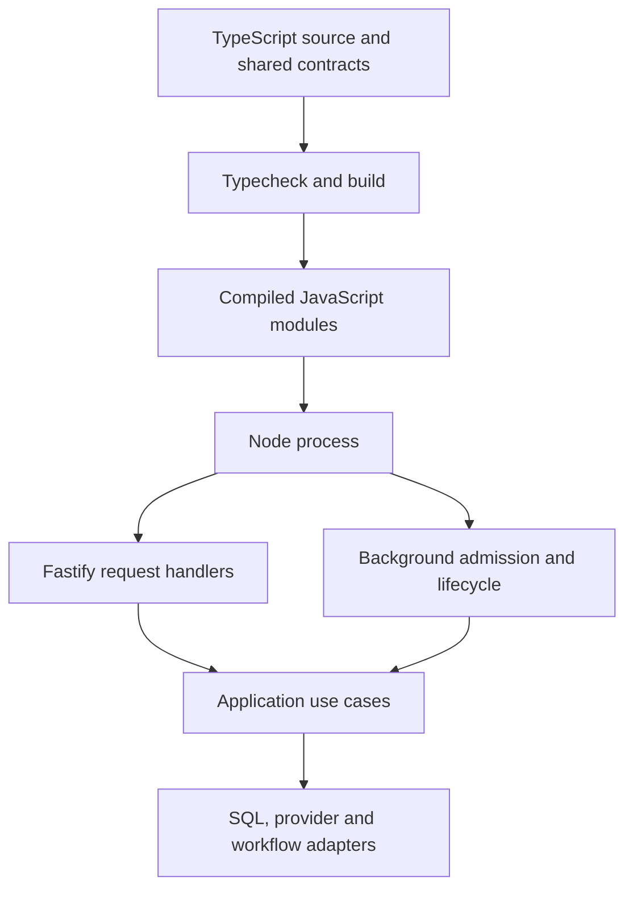

# 2. Node.js, TypeScript and execution boundaries

Prepared from the module/runtime structure at `7c37d96` and the separately
queued read-boundary improvements documented in the release records. This is
teaching material; implementation, CI, publication and learner progress are
different states. Recheck the current source before the shared exercise.

## A Node process runs the backend

Node is the JavaScript runtime. Fastify is the HTTP framework running inside it.
TypeScript is the language/tooling used to check and build our source. LangGraph
is one workflow implementation inside the application; it is not the runtime
that replaces Node or the framework that owns all HTTP requests.

[server.ts](../../apps/api/src/server.ts) starts telemetry, creates the
application, builds the HTTP server, starts background timers and registers
shutdown handlers. [app.module.ts](../../apps/api/src/app/app.module.ts) is the
composition root: it chooses concrete implementations and connects their typed
dependencies. Controllers adapt HTTP to use cases; repositories adapt product
storage operations to SQL.



The repository uses ESM and NodeNext module resolution. A TypeScript file may
import another local module using a `.js` suffix because that is the compiled
file Node will load. Development uses the existing TypeScript runner; production
uses the compiled runtime. Read [tsconfig.json](../../apps/api/tsconfig.json)
and the [API scripts](../../apps/api/package.json) together to see the difference.

The runtime build has explicit application roots and excludes project tests.
Database migrations are separate required runtime assets. “The compiler passed”
does not prove an image contains its SQL files, native OCR tools or the right
entry points; the image checks test those responsibilities separately.

## What async and await mean here

An asynchronous function returns a Promise. Awaiting a provider response or
database operation suspends that function's continuation while other work can
make progress. It does not move arbitrary JavaScript computation to another CPU
thread. A long synchronous loop can still delay unrelated requests in the same
process.

Concurrency means several operations can be in flight. Parallel CPU execution
is a different mechanism. External OCR processes, database work and model servers
have their own execution/resource limits; they do not make unbounded work safe
just because the Node caller uses `await`.

In [ingest-document.ts](../../apps/api/src/modules/ingestion/application/use-cases/ingest-document.ts),
embedding workers share a bounded work list. Notice two details: the concurrency
limit is explicit, and a failure aborts sibling work before awaiting its
settlement. Promise.all alone rejects when a member rejects; it does not cancel
the other operations. Without cancellation/settlement, a failed upload could
leave calls running while the caller already reports failure.

The HTTP worker timer in server.ts also avoids starting another admission pass
while the prior pass is active. With durable workflows enabled, admission and
execution are different operations: accepting a persisted job is not waiting for
the entire graph to finish. We will inspect the runner's own concurrency, leases
and kind-specific scheduling in the durability lesson.

## TypeScript checks code; it does not inspect network data

An interface describes what application code expects. It is erased when the
program runs. Asserting a value with `as SomeType` does not check that value. A
database driver generic likewise describes an expected result; it cannot prove
every actual JSON, scalar or Date has that shape.

Lumora uses existing Zod schemas at interpreted boundaries. HTTP DTOs and
provider envelopes are external data. Stored JSON and driver projections also
need checks where code interprets them. Reuse the semantic contract, but respect
different representations: a SQL Date is a Date object, while JSON transports an
ISO string. A wire-schema date check must not replace the physical driver check
with an unsafe serializer call first.

Missing, null and zero are distinct. An unmeasured provider cost is not a free
request. A legitimate SQL COALESCE zero for an empty usage window is useful; an
empty string or invalid value must not silently turn into a measurement through
Number conversion. Similarly, a nullable chunk count is different from zero
completed chunks. Existing constraints, output schemas and repository decoders
cover different points in the flow; do not label a type assertion alone an
authorization vulnerability.

The [stored-record helper](../../apps/api/src/platform/database/stored-record.ts)
turns an incompatible interpreted record into a fixed error. It intentionally
does not attach the stored value or parser cause. We need enough operational
information to identify the failure category without copying a private passage
or provider body into logs.

The API currently enables strict typechecking, unused-symbol checks, return-path
checks and switch-fallthrough checks. These catch useful mistakes but do not
prove runtime behavior, correct tenant predicates or safe external effects.
Read the compiler settings and the behavior tests as complementary controls.

## An interface gives a module a capability

The actual [EmbeddingProvider port](../../apps/api/src/modules/ai/application/ports/embedding-provider.ts)
defines an embed capability returning a vector, optional cancellation and usage
observation, plus workspace index resolution when supported. A use case can
request that capability without importing a vendor SDK.

The [workflow factory port](../../apps/api/src/modules/chat/application/ports/answer-workflow-factory.ts)
accepts a retriever, answer generator and workflow options. The root
[workflow binding](../../apps/api/src/app/composition/chat-workflows.ts) supplies
the LangGraph implementation and tracing decorator. This is the concrete
Adapter/Factory/Dependency Injection use here: business requirements stay in
typed contracts, and deployment-specific assembly stays outside them.

An adapter does more than rename methods. Bedrock, OpenRouter and Ollama have
different request/response shapes and usage conventions. Each adapter must
preserve the application's cancellation, vector validation, structured answer,
usage and error contract. A compatible TypeScript method signature cannot prove
those semantics; focused adapter tests exercise them.

Changing an embedding adapter also does not migrate an existing index. Model
identity, dimensions, index revision, staged vectors and cache eligibility are
separate data guarantees. We will follow the explicit reindex/activation path
before calling an embedding replacement safe.

## Deadlines must stop the work

A timeout Promise can stop a caller from waiting while the underlying request
continues. Lumora passes AbortSignal through the relevant use cases and provider
client, and combines parent cancellation with bounded provider deadlines. Read
[provider-client.ts](../../apps/api/src/platform/http/provider-client.ts).
Cancellation has to reach the concrete operation; a prompt saying “stop after
ten seconds” is not a timeout guard.

The same distinction matters for SQL. The
[transaction boundary](../../apps/api/src/platform/database/sql-boundary.ts)
combines server statement/lock/idle limits with an outer lifecycle deadline.
Aborting a checked-out client discards its connection once; normal completion
releases it for reuse. Setup and rollback also belong to the lifetime being
bounded. An interrupted or failed connection must not return to the pool as if
it were a healthy idle client.

These helpers retain more restrictive role/database settings instead of relaxing
them. A read-only transaction is enforced by PostgreSQL, while membership and
scope remain application responsibilities. A shared API credential and a
separate minimum-privilege MCP credential are different operational choices.

## A transaction is not a promise of exactly-once effects

A transaction groups related SQL changes so they commit or roll back together.
It can protect upload deduplication, membership checks, leases and completion.
It does not undo a paid model call or an email already accepted by a remote
service. Those effects need their own identity, authorization, retry and
ambiguous-outcome policies.

That is why provider retries distinguish a rejected rate-limit response from
an ambiguous paid request, and why workflow effects have persisted receipts.
Do not automatically retry every error or interpret a disconnected response as
proof that nothing happened. Outbox delivery and future write-capable tools have
additional boundaries covered in the resilience/agent lessons.

Shutdown is part of correctness too. The server stops admitting background
passes, closes HTTP, drains/aborts owned work, closes resources and flushes
telemetry within a bounded lifecycle. A controller that disappears while calls
continue can leave incorrect product state or duplicate work after restart.
The [shutdown implementation](../../apps/api/src/platform/lifecycle/shutdown.ts)
and its tests explain these guarantees more precisely than a generic finally
block around server startup.

## Reading a test without mistaking it for production evidence

Native unit tests use small controlled capabilities to exercise decisions and
failure paths. A fake embedding provider proves how the use case handles a
vector; it does not measure that provider's semantic quality. Real PostgreSQL
fixtures test SQL/transaction/driver behavior. Browser tests exercise navigation
and interaction. Actual image checks verify packaged runtime resources and OCR.
The capacity lab measures an isolated process under a stated synthetic load.

The event-loop histogram planned for that lab runs in the API process, not the
driver. Its timer-based delay, sampling resolution, utilization, Docker CPU and
request latency are different measurements. Missing checkout-wait data cannot
be inferred from them. Previously unmeasured reports must stay unmeasured.

## Shared exercise

With the existing local Node 24 setup, these checks use the repository's
configured tooling without starting paid providers:

```sh
npm run typecheck
npm run check:architecture
```

Run them sequentially; both may build shared contracts. The first checks code
types. The second checks dependency directions/cycles and structural/runtime
graphs. Neither replaces application behavior, real SQL or provider evaluations.

Open EmbeddingProvider and identify the Promise, input-type union, optional
AbortSignal and usage callback. Follow one constructor dependency from
chat.module.ts to its root binding. Then explain what would happen if a provider
returned a vector with the wrong dimension, a Promise rejected while siblings
were active, or a SQL connection failed during rollback.

During the teaching session, we will follow one real focused test and make a
bounded local change together. No production mutation or learner completion is
implied by preparing this chapter.
