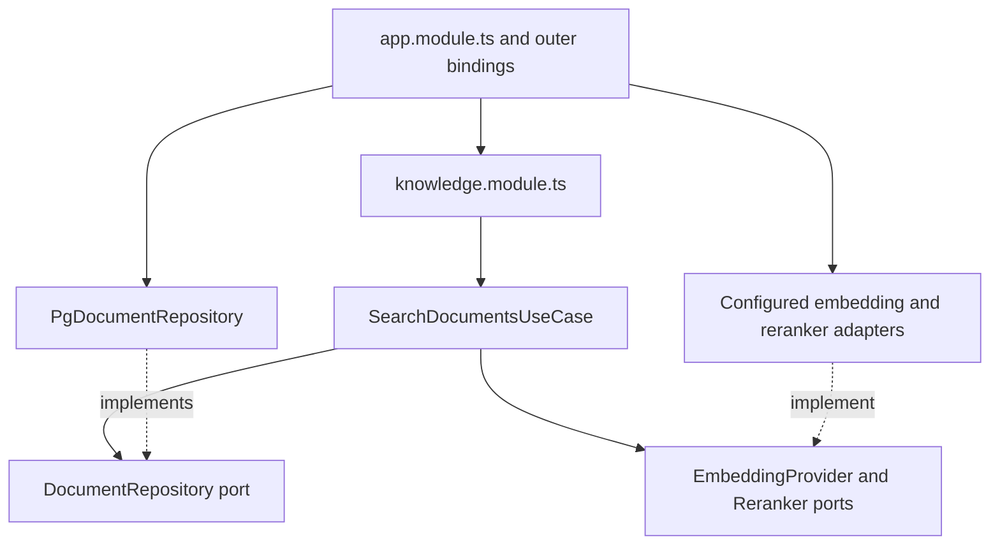

# 3. Modules, ports and dependency direction

Prepared against `ce17d1d` and the existing BE-15 module boundaries. Read this
with the [module guide](../backend-modules.md) and
[architecture checks](../architecture-checks.md). This chapter is prepared
material, not a completed teaching session or evidence that every optional
adapter is enabled. Recheck the source before conducting the exercise.

## Start with one product operation

Suppose a teammate searches the active workspace's documents. The product
needs to validate access, prepare a query, retrieve evidence and return safe
passage previews. PostgreSQL is one way to retrieve that evidence. OpenRouter
or Ollama may provide an embedding. None of those vendor names defines the
business operation itself.

Organizing by feature gives us places to find those responsibilities:

```text
apps/api/src/
  app/                         Application assembly and HTTP composition
  modules/
    knowledge/
      knowledge.module.ts      Assemble knowledge services from typed dependencies
      search.controller.ts     Adapt an HTTP request to a knowledge operation
      application/
        ports/                 Required capabilities, expressed as types
        use-cases/             Product operations and their policies
      domain/                  Document and chunk concepts
      infrastructure/          Concrete SQL and storage implementations
      index.ts                 Deliberate cross-module Public API
  platform/                    Shared technical policies and lifecycle mechanisms
```

This has the feature-oriented organization the owner requested. It uses Fastify
and explicit factories; it is not a NestJS migration. A folder name alone does
not enforce isolation. The imports and tests must agree with the intended
responsibilities.

## Follow the actual search dependencies

[SearchDocumentsUseCase](../../apps/api/src/modules/knowledge/application/use-cases/search-documents.ts)
receives an embedding capability, document repository, reranker and plain
options through its constructor. It resolves or accepts a versioned query
embedding, prepares the lexical query, asks for hybrid candidates and applies
the configured reranking path. It forwards cancellation and checks it between
stages.

The use case imports types from ports and module Public APIs. It does not create
a PostgreSQL connection, read a provider key or import a graph SDK. The concrete
SQL ranking implementation lives in
[PgDocumentRepository](../../apps/api/src/modules/knowledge/infrastructure/postgres/pg-document-repository.ts).



These arrows explain construction and code dependencies. At runtime the use
case calls the actual adapter object passed to it. Dependency inversion does
not make runtime calls run backwards or eliminate the database.

The [DocumentRepository port](../../apps/api/src/modules/knowledge/application/ports/document-repository.ts)
describes operations such as `findHybrid`, `listChunks`, `replace` and `delete`.
It is a product-specific contract rather than a generic `Repository<T>` wrapper.
That keeps workspace, index version, limits and cancellation visible where they
matter. A new storage implementation must preserve those semantics, not merely
return a similarly shaped array.

## Where concrete choices belong

[createKnowledgeServices](../../apps/api/src/modules/knowledge/knowledge.module.ts)
constructs the use cases from supplied ports. The outer
[PostgreSQL bindings](../../apps/api/src/app/composition/postgres-persistence.ts)
choose concrete repository classes. The
[application root](../../apps/api/src/app/app.module.ts) creates and shares the
pool, selects configured providers and assembles the modules.

| Responsibility | Actual owner | Why it belongs there |
| --- | --- | --- |
| Current request identity and workspace membership | HTTP authorization and identity/workspace capabilities | An embedding provider must not decide who can read a workspace |
| Candidate counts, index version and optional reranking | Search use case with explicit options | These choices define the search operation |
| SQL syntax and driver row decoding | PostgreSQL adapter | A business factory should not depend on a driver-specific row |
| Provider URLs, credentials and response formats | Configuration and selected adapters | They vary by integration |
| Creating and closing the shared pool | Application composition and lifecycle | Features must not each create unmanaged global resources |
| Safe public preview | Existing passage policy and HTTP serializer | Returning a search match is different from disclosing full content |

These are complementary safeguards. Constructor injection is not authorization.
A typed repository is not proof of tenant isolation. A runtime schema is not a
substitute for database constraints. Follow the concrete request and tests to
see which check runs at each boundary.

## Which patterns are actually useful here?

- **Dependency injection:** passing the required capabilities explicitly rather
  than constructing hidden globals in each use case.
- **Adapter:** translating a port into PostgreSQL, a provider API, storage or
  a workflow implementation while keeping that integration's details outside
  the consumer.
- **Factory:** assembling a coherent set of services and options. A plain
  function is enough; no container or decorator is required.
- **Strategy:** selecting an embedding, reranker or workflow implementation
  through its contract. Selection remains subject to workspace policy and
  code-enforced budgets.
- **Repository:** giving application operations a persistence contract. It does
  not mean every table needs a wrapper class or every query needs another layer.

Replacing an adapter can still require real engineering. A new vector store
must support the required tenant filters, index versions, ranking and consistency
behavior. A new embedding model can change dimensions and requires the explicit
reindex/cutover procedure. A different graph runner needs equivalent recovery,
approval, cancellation and budget semantics. The abstraction makes the boundary
visible and testable; it does not make those guarantees automatic.

## Frontend boundaries solve a different organization problem

The frontend follows `app → pages → widgets → features → entities → shared`.
Higher layers compose lower layers. A sibling slice is consumed through its
named Public API; code inside a slice uses its own implementation files directly.
The small Shared layer has deliberate leaf imports rather than a giant barrel.

For example, the
[workspace control-center Public API](../../apps/web/src/widgets/workspace-control-center/index.ts)
exports its container. Its section implementations can remain separately lazy
loaded. Making every internal section public would weaken the boundary and can
also change bundling behavior.

FSD is a frontend composition scheme. Backend feature modules use their own
domain/application/infrastructure organization. Both applications can consume
`packages/contracts`; neither imports the other application's source.
Shared wire contracts describe what crosses the API, not PostgreSQL records or
all internal domain objects. Runtime decoding is still needed for external data.

## A safe local experiment

Use a checkout with dependencies already installed and the declared Node version.
No cloud configuration, real document or model call is required.

```bash
nvm use
npm run check:architecture
npm run test:architecture
```

The first command after Node selection checks the actual production dependency
graphs. The second creates disposable fixture trees, introduces prohibited
imports and verifies that the gate exits unsuccessfully for those cases. An
expected failing fixture is a passing test; the repository itself must remain
free of blocking violations.

Open the
[architecture fixtures](../../tests/architecture/architecture.test.mjs) and locate
one private slice import, one upward import, one concrete adapter import from
application code and one runtime cycle. Explain why each should fail. Then find
the legal type-only Public API fixture. Type-only imports are erased at runtime
but still participate in structural boundary checks.

Next read the
[module assembly tests](../../apps/api/src/app/integration-tests/module-assembly.test.ts)
and [port replacement tests](../../apps/api/src/app/integration-tests/module-ports.test.ts).
Observe where fixtures throw if assembly attempts unexpected database/provider
I/O. Construction and execution are different phases. Do not replace a real
production adapter to perform the exercise.

The gate cannot prove business correctness, permission safety, semantic retrieval
quality or that a new vendor preserves all operational guarantees. Those need
their own behavior, integration, evaluation and release evidence.

## Explain it back

Before checking any learning outcome, the learner should be able to:

1. Find one controller, use case, port, adapter and composition factory.
2. Explain what changes when PostgreSQL or an embedding provider is replaced.
3. Identify who creates and closes the pool, and why the use case should not.
4. Explain the difference between a compile-time port and a runtime data check.
5. Show one architecture violation rejected in a disposable fixture.
6. Name one correctness/security property the import gate cannot prove.

Keep the chapter's learner checkboxes in the main walkthrough open until the
interactive exercise and explanation have actually happened.
