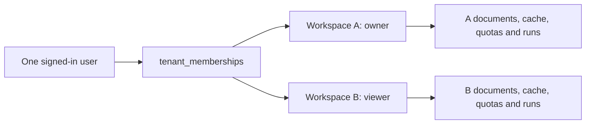
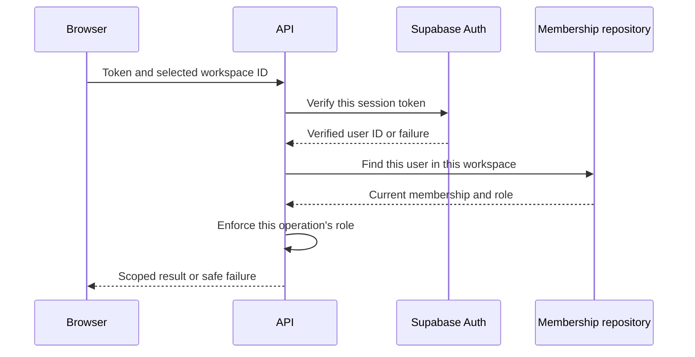

# 4. Identity, workspaces and access

Prepared against the source structure at `577e500`. This chapter explains the
current implementation and its explicit exceptions. It is prepared material;
the interactive lesson and learner outcomes remain pending.

## One account, different permissions in different workspaces

A workspace is a separately authorized knowledge collection and team context.
It is not a separate Node server or a separate language model. The shared API
and PostgreSQL database store documents under `tenant_id`, while
`tenant_memberships` associates a user with a role in each workspace.

For example, the same person can own Team A and view Team B. The ability to
upload into A does not grant permission to upload into B. Asking the same
question in each workspace must retrieve only that workspace's sources.
The product is general-purpose; the IT/Legal names in some older fixtures are
test examples rather than required customer categories.

Read [migration 010](../../apps/api/db/migrations/010_tenant_memberships.sql)
and [the membership repository](../../apps/api/src/modules/workspaces/infrastructure/postgres/pg-tenant-membership-repository.ts).
The composite membership key is `(tenant_id, user_id)`; a user ID alone does not
describe the person's role everywhere.

## Authentication answers who; authorization answers what here

The [sign-in page](../../apps/web/src/pages/sign-in/ui/SignInPage.tsx) currently
uses Supabase Auth email/password sign-in. The
[application session hook](../../apps/web/src/app/model/use-application-session.ts)
owns the browser auth subscription, handles sign-out and clears identity-scoped
query state when the account changes. An old account's cached screen should not
appear as the next account's data.

For protected API operations the browser sends a bearer session token. The
[identity adapter](../../apps/api/src/modules/identity/infrastructure/auth/supabase-identity-gateway.ts)
calls Supabase `auth.getUser(token)` with the supplied token; it does not set a
shared server session or trust a browser's decoded user metadata. It checks the
returned user UUID and applies response-size, timeout and cancellation bounds.
This implementation should not be described as custom local JWT signature
verification.

[RequestIdentity](../../apps/api/src/modules/identity/http/request-identity.ts)
shares the verification Promise only within that request object. New requests
are verified again. This avoids duplicate work in one handler chain without
creating a long-lived global user/permission cache. Client disconnects cancel
verification work and listeners are removed in `finally`.

The request's workspace ID is a selection, not authority. The backend checks
the current membership before using it as an authorized scope. Editable
`user_metadata.role` or `user_metadata.tenantId` does not grant access.

## Selection and roles are explicit policies

[createWorkspaceAuthorization](../../apps/api/src/platform/http/workspace-authorization.ts)
builds user/member/editor-or-owner/owner authorizers. Its relevant behavior is:

| Situation | Expected protected-workspace behavior |
| --- | --- |
| No session | Authentication failure |
| Invalid or duplicated workspace selection | Reject before membership lookup |
| Several memberships, no selection | `workspace_required`; do not choose another team's corpus |
| Exactly one membership on a compatible endpoint | That membership may be used without a header |
| Endpoint explicitly requires selection | Missing selection fails even with one membership |
| Selected workspace without membership | Deny access |
| Viewer attempting an editor/owner operation | Deny access |
| Auth service unavailable or timed out | Safe unavailable/timeout response; no default privileged identity |

Original downloads and ingestion previews require explicit scope. Their roles
also differ: viewers can read authorized originals, while the administrative
ingestion preview requires editor/owner access. Read each controller's actual
authorizer rather than assuming every route containing `admin` means owner-only.

Workspace creation is a user operation: an authenticated person without a
membership can create a workspace and become its owner. That does not allow
reading a default private corpus before the membership exists. Creation inserts
the workspace and owner membership transactionally.

Some public demo and legacy API-key routes have separate policies. They do not
remove identity checks from private originals, conversations, team or MCP access.
Do not turn a demo exception into a generic authorization fallback.

## Application checks, SQL filters and RLS do different work

1. **Application authorization** verifies identity, current membership and the
   operation's role. It can refuse the request before quota, provider or file work.
2. **SQL scope** binds the verified tenant and joins document ownership. It
   prevents a repository operation from accidentally reading another corpus.
3. **RLS** is database policy evaluated for the actual database role and session.
   [Migration 014](../../apps/api/db/migrations/014_workspace_rls_policies.sql)
   defines membership-based authenticated reads and leaves operational tables
   without browser-facing policies.

A privileged server connection may not have the same RLS behavior as a browser
session. Therefore RLS is not a reason to omit application checks or tenant
predicates. Read-only transactions prevent writes within those transactions;
they do not prove that the credential itself has minimum privileges. The live
dedicated MCP read-role rollout remains the separate BE-09 backlog item.

RLS also does not run the API's passage clipping, PII masking or tool-output
schema. Direct database/API grants need their own field and data-handling review.
The browser hiding a button, the model promising to stay in one workspace and
an import graph passing are not replacements for any of these access controls.

## Which keys belong in the browser?

The [browser Supabase client](../../apps/web/src/shared/lib/supabase.ts) uses
the project URL and publishable key. Its authority is constrained by the user's
session and configured database/storage policies. It is not the server's service
role or a model-provider secret.

Server-only service-role credentials support bounded administrative identity,
invitation and storage operations. OpenRouter and other provider keys stay on
the server as well. A legacy administrator API key is not a credential to embed
in the public React application. The ordinary product flow uses verified users
and workspace membership.

Do not copy token values into lesson notes, logs, screenshots or command-line
examples. Understanding these paths does not require revealing a real secret.

## Invitations and the two different Supabase accounts

The Supabase dashboard account belongs to the person operating the cloud
project. It may use GitHub SSO. A Lumora application's Auth user belongs to the
project's application user directory. Changing the dashboard login does not
create or reset an application's user password.

The [invitation use case](../../apps/api/src/modules/workspaces/application/integrations/workspace-invitations.ts)
uses the configured invitation gateway and a delivery journal. It validates the
email/role, deduplicates retries, records a bounded delivery attempt and checks
current authority. A repeated request should not blindly send another email or
turn an uncertain delivery into confirmed success. An accepted Auth invitation
and a workspace membership are related records with different responsibilities.

Actual email delivery requires the configured provider and mail settings; local
fixtures can teach the retry/authorization behavior without sending a message.

## Local exercise and evidence

Open the [workspace scope tests](../../apps/api/src/app/integration-tests/workspace-scope.test.ts).
Find the fixture that includes forged owner/workspace values in user metadata.
Explain why the server still uses the membership repository. Then locate the
same-question/two-workspace case and the rejection of ambiguous selection before
retrieval or quota consumption.

Compare that with the actual PostgreSQL/MCP and browser fixtures referenced in
the [technical backlog](../technical-backlog.md). A mocked route test proves
handler behavior; actual SQL tests prove database behavior; a real user's
end-to-end login proves a different environment-specific path. None should be
silently presented as the other.

Use only disposable local accounts/workspaces for an interactive exercise. Do
not invite a real teammate, alter production roles or paste a live token merely
to follow the chapter.

## Explain it back

Before marking the learning outcomes complete, explain:

1. Why a valid login does not imply owner access to every workspace.
2. Why the selected workspace header is not a permission grant.
3. How one request avoids duplicate identity verification without caching
   permission across future requests.
4. Why a hidden upload button, an SQL tenant filter and RLS are separate controls.
5. The difference between the Supabase dashboard account and a Lumora Auth user.
6. Which checks must fail before a private document or provider call is reached.
