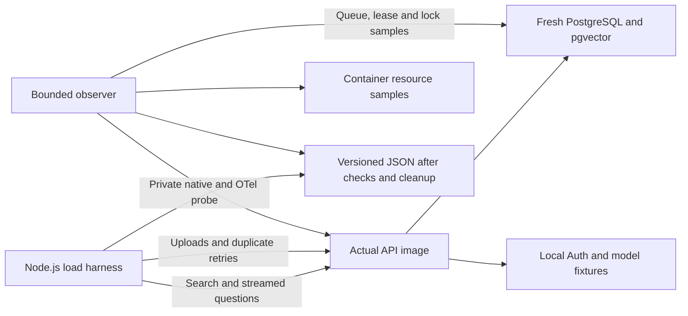

# BE-13 instrumented sustained load result

## Result and evidence

The declared sustained scenario passed: ten workspaces, 50,000 chunks, ten
simultaneous clients and 30 minutes of mixed search, streamed answers and
ingestion. The mixed phase completed **10,022 search/answer pairs with zero
unexpected failures**. All six deduplicated ingestions and new-source checks
passed. Native event-loop, guarded-checkout and scoped workflow-queue evidence
is present. All owned processes stopped without OOM and cleanup succeeded.
BE-13 remains partial; this is one controlled synthetic workload.

- Exact tested source: `75f758392f424c672eee9f2bf2369308ce3182bd`.
- [Capacity run 42496102159](https://github.com/willianmesko/rag-study-mvp/actions/runs/42496102159),
  job `128778683364`, artifact `13624434158`.
- Artifact ZIP SHA-256:
  `fa4da08d309eface7f7ef02db9dcc18492bd5d81897845d20759773ec73880b2`.
- [Complete reviewed version-three JSON](../../reports/capacity/reviewed/sustained-75f7583.json),
  SHA-256 `bf469e17ff826ffe9c37b396be56ff804a69aedec8c01729b64737c3b41a9adc`.
- [All four fresh quality jobs](https://github.com/willianmesko/rag-study-mvp/actions/runs/42496102160)
  passed, including 410 UX cases/46 intentional profile skips, 100 PostgreSQL
  cases without skips, isolated index cutover, architecture/harness and image
  checks. Eighteen capacity/probe cases also pass without skips.

Application and lab code are unchanged from the published `151ccef`; the launch
commit adds the reviewed experiment record. This measurement does not need an
application deployment. Production remains at `151ccef`. Hosted OTLP export and
the optional model-performance release gate were not activated.

## How the test works

The existing Node.js harness drives the actual API image over HTTP on an owned
internal Docker network in GitHub Actions. PostgreSQL/pgvector and durable
workflows are real; Auth, embedding and chat services are deterministic local
fixtures. No production database, private document or paid model is used.



The corpus has 40,000 chunks in workspace zero and 10,000 across nine others,
using the unchanged corpus version two and deterministic 1024-dimensional
vectors. There are twenty synthetic accounts per workspace. Ten clients each
perform a search, consume the answer stream through checked completion, pause
150 ms and repeat. The stride gives one client to each workspace in this cohort.
This is a closed-loop scenario, not a fixed offered request rate or tenant flood.

After exact-vector reference/source checks, run 60 seconds of API-only control.
Then run 1,800 seconds of the same traffic while submitting six Markdown uploads
to the largest workspace, each replayed with the same idempotency key. Require
six unique completed jobs, then search and answer against each new source.
Inspect durable terminal records/checkpoints before stopping owned resources.

The harness validates schemas and workspace/document/chunk ownership while
reading search results, citations and final answers. A scope/citation assertion
or failed request stops traffic and fails the run. Viewer upload and invalid
cross-workspace membership are explicitly denied. These functional checks do
not establish semantic quality, exhaustive attack resistance or real LLM accuracy.

Implementation:
[profiles](../../scripts/capacity/profiles.mjs),
[driver](../../scripts/capacity/run.mjs),
[traffic and stream checks](../../scripts/capacity/traffic.mjs),
[isolated containers](../../scripts/capacity/docker-lab.mjs),
[native probe](../../scripts/capacity/event-loop-probe.mjs),
[checkout collector](../../scripts/capacity/checkout-probe.mjs) and
[workflow queue sampling](../../scripts/capacity/workflow-queues.mjs).

## Environment and execution

The driver ran from **15:42:57.152 to 16:18:05.465 UTC on 2026-11-08**.
Seeding took 220,679 ms. The standard runner used the fixed 45-minute process
deadline and 48-minute job cap; no deadline or success guard was relaxed.
The report retains exact image IDs, lock digest, configuration and query plans.
PostgreSQL was 16.15 and pgvector 0.8.7 in this disposable run.

| Container | CPU cap | Memory cap | Peak sampled CPU | Peak Docker memory display |
| --- | ---: | ---: | ---: | --- |
| API | 0.5 CPU | 512 MiB | 47.34% | 229.3 MiB / 512 MiB |
| PostgreSQL | 2 CPU | 2 GiB | 141.64% | 293.7 MiB / 2 GiB |
| Fixture provider | 1 CPU | 256 MiB | 2.96% | 22.75 MiB / 256 MiB |

Docker CPU percentages are relative to one core; memory displays are container
measurements, not Node heap/RSS. These are sampled peaks, not continuous maxima
or a memory-leak investigation. API/provider roots are read-only, no host ports
are published, and fixture traffic remains on the internal network. Setup still
downloads normal build dependencies/images. The encryption key is ephemeral.

The actual image passed two native OCR checks without skips and retained 498
runtime files / 1,566,557 bytes / 14 roots / zero project test artifacts. Its SQL
catalog remains 31 files / 52,893 bytes, digest
`f3d3581a9a83a1568390cc0d249968dcec8016d09596a1004e043f6d711c253b`.

## Request results and comparison

The earlier [sustained report](capacity-sustained-result.md) remains pinned to
`7c37d96`. Its JSON is unchanged, SHA-256
`cc46049370ba077dac7150529aa51309b2bf2b038f48a980d2ec261a25b3f618`.
Configuration, corpus and lockfile digest match; application source, image/runner
identities and instrumentation differ. This is a descriptive comparison of two
cohorts, not a paired regression experiment or proof of a particular optimization.

| Measurement | Earlier control | New control | Earlier mixed | New mixed |
| --- | ---: | ---: | ---: | ---: |
| Nominal duration | 60 s | 60 s | 1,800 s | 1,800 s |
| Completed search/answer pairs | 226 | 364 | 7,748 | 10,022 |
| Unexpected failures | 0 | 0 | 0 | 0 |
| Search p95 | 300.087 ms | 247.311 ms | 337.523 ms | 204.445 ms |
| First SSE event p95 | 127.449 ms | 95.976 ms | 43.489 ms | 22.729 ms |
| First validated text p95 | 3,525.339 ms | 2,086.980 ms | 3,065.272 ms | 2,510.091 ms |
| Validated completion p95 | 3,525.536 ms | 2,087.010 ms | 3,065.374 ms | 2,510.180 ms |
| Semantic cache hits | 0 | 0 | 0 | 0 |

p95 means 95% of that phase's measured samples are at or below the reported
value; it is not a maximum or guarantee. First event can be a status, not answer
text. The new mixed phase achieved about 5.57 pairs per nominal second in this
closed-loop workload; that is not the maximum supported request rate.

The new control/mixed completion p95 values differ despite identical client
counts. Unequal phase lengths, process/database warmup, scheduling, durable
delivery polling and ingestion all affect them. Do not infer that ingestion
improved or worsened latency from these aggregate values. Clearing the owned
semantic cache between phases is not a cold database/OS-cache experiment.

All ten workspaces made progress. The largest completed 834 mixed pairs with
search p95 379.601 ms and completion p95 2,580.294 ms; the others completed
1,014–1,030 pairs each, with search p95 144.591–167.611 ms. This still shows a
size-related retrieval cost. Equal client allocation does not prove fairness
under a heavy-tenant flood. All thirty synthetic reference comparisons have
full overlap at five; this is neither general ANN recall nor faithfulness.

## New native and guarded-checkout measurements

Both phase boundaries reset/discard prior probe data and collect their own
windows. The old long report's unknown fields are not backfilled.

| Native event-loop measurement | Control | Mixed |
| --- | ---: | ---: |
| Samples | 2,779 | 82,518 |
| Histogram p95 | 21.119 ms | 21.201 ms |
| Histogram p99 | 100.008 ms | 99.811 ms |
| Maximum | 105.710 ms | 214.172 ms |
| Event-loop utilization | 33.65% | 29.16% |

The native timer histogram uses 20 ms resolution. These timer-scheduling values
are not added latency per request, the request p95, or an exact attribution to
GC, CPU throttling or SQL. Utilization is not Docker CPU percentage.

| Guarded client acquisition | Control | Mixed |
| --- | ---: | ---: |
| Acquired observations | 6,552 | 180,504 |
| Mean, sum/count | 0.011005 ms | 0.011817 ms |
| Maximum observed duration | 1.181982 ms | 87.707841 ms |
| Acquisitions in the (0, 1] ms bucket | 6,551 | 180,484 |
| Cancelled / failed observations | 0 / 0 | 0 / 0 |

Of the twenty mixed acquisitions above 1 ms, ten are in (1, 5], two in (5, 10],
one in (10, 25], one in (25, 50] and six in (50, 100] ms. The p95 lies within the
(0, 1] ms bucket; no exact checkout p95 can be recovered from that bucket.
Empty cancellation/failure windows have null durations, not fabricated zeros.
Their behavior has separate [native and max=1 real-SQL proof](postgres-checkout-measurement.md).

This existing OTel instrument measures guarded acquisition until handoff,
failure or cancellation, including connection establishment/setup. It excludes
subsequent SQL, direct pool.query/unguarded connect, and pure pool queue wait.
Counts aggregate foreground/background guarded paths across pools, not requests
or a particular tenant/pool. The 87.7 ms outlier does not identify its cause or
prove pool saturation. Keep `poolWaitMs` null. Native/probe/SDK collection adds
overhead; this run does not isolate that overhead or activate hosted OTLP export.

## Queues, durable work and cleanup

All 618 periodic observations succeeded; 62 sampled lock waiters. The maximum
sampled active database queries was six. Lock waiter/query counts do not measure
the duration or exact source of waits. The legacy ingestion_jobs queued count
peaked at one, with maximum sampled queued age 1,869.544 ms; that excludes
processing jobs awaiting an admitted durable runner.

| Workflow kind | Max ready/queued | Max running/leased | Max sampled ready age | Expired/missing lease observations |
| --- | ---: | ---: | ---: | ---: |
| Chat | 7 / 7 | 3 / 3 | 2,156.344 ms | 0 / 0 |
| Ingestion | 2 / 2 | 1 / 1 | 1,217.953 ms | 0 / 0 |
| Evaluation | 0 / 0 | 0 / 0 | Unknown; no ready work | 0 / 0 |

These are independently sampled maxima, not a simultaneous state or continuous
bound. Evaluation work/approval was not load-tested. A separate six-row fixture,
before the API starts, verifies ready/future work, valid/expired/missing leases,
approval state, tenant scope and exact deletion without dispatching those rows.
Zero invalid leases in workload samples is not a restart/recovery proof.

Six uploads accepted and replayed produced exactly six completed jobs. Queue to
source_read/started p95 was 3,951.558 ms, a different population/interval from
sampled ready age. Six later searches and six answers verified the new sources.
There are 10,392 completed chat runs (364 + 10,022 + six later answers), six
completed ingestion runs and 62,364 encrypted checkpoints, with no noncompleted
owned workflow rows at receipt time. Checkpoint existence alone is not proof of
recovery across a process restart.

The three containers exited zero without OOM; owned container/network/volume
cleanup recorded zero failures. No broad Docker prune was used. Reviewed data
contains measurements, not questions, documents, credentials or raw error bodies.

## Reproduction and decisions

In GitHub Actions, select **Capacity lab → Run workflow → profile: sustained**.
The existing [workflow](../../.github/workflows/capacity-lab.yml) records the
selected source automatically. For the historical cohort, use the recorded
launch source; future main runs are new measurements with their own identity.
On a disposable Linux Docker host with Node 24, use the repository root:

```sh
npm ci --no-audit --no-fund
npm run build:contracts
npm run test:capacity
docker build --tag lumora-api:capacity-ci --file apps/api/Dockerfile .
GITHUB_SHA="$(git rev-parse HEAD)" node scripts/capacity/run.mjs --image lumora-api:capacity-ci --profile sustained --report-id instrumented-sustained
```

The actual lab expects Linux-owned private network addresses; use CI for the
image-based run from macOS. No application .env file is read. See the
[launch/deadline rules](capacity-sustained-run.md) and
[lab safety/reproduction guide](capacity-lab.md).

Keep the demonstration topology and budgets. This cohort shows sustained
progress and working instrumentation under its declared limits; it does not
justify buying resources, adding replicas or changing indexes by itself.
Inspect per-stage SQL/lock/pure queue behavior before attributing the observed
retrieval/lease/checkout tails to a specific bottleneck.

BE-13 still needs pure queue wait and remaining direct paths, slow readers and
cancel/reconnect pressure, crash/restart recovery, large PDF/DOCX/OCR and
reindex/evaluation bursts, tenant floods, growth/stress and multi-replica/shared
limiter scenarios. Real Auth/provider latency, OpenRouter model behavior/cost,
Render/Supabase capacity and production SLOs require a separate bounded run
against those services. Actual provider cost remains null here. No real-provider
or hosting capacity conclusion is certified, and no model-performance baseline
or production monitoring exporter is enabled by this measurement.
