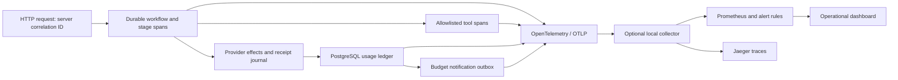

# Observability, security and cost controls

Lumora emits bounded operational signals. It does not send questions, answers,
passages, document names, emails, IPs, bearer tokens, URLs, provider responses or
exception stacks to the tracing backend. Product records remain separately
protected by membership and conversation ownership.

## Signal flow



`x-request-id` is generated by the API, returned on responses and stored on
admitted workflows. Reconnection does not replace the original workflow
correlation ID. IDs are span/log attributes, never metric labels. Workflow nodes,
provider effects and MCP tools emit duration and reason-coded outcomes. Approval
waits are `waiting / approval_required`, not failures. Cancellation, revoked
access, lost leases, deadlines and budget exhaustion have distinct codes.

## Local monitoring

The optional stack is independent of the application Compose file and creates
no hosted resource. Its published ports bind to loopback. Data is disposable;
the example is for local operations practice, not a public monitoring deployment.
Versions were checked against upstream releases on 2026-11-07.

```bash
export OBS_GRAFANA_ADMIN_PASSWORD="$(openssl rand -hex 24)"
docker compose -f ops/observability/compose.yml up -d
# In the terminal that starts the API:
export OTEL_ENABLED=true
export OTEL_EXPORTER_OTLP_ENDPOINT=http://localhost:14318
export OTEL_EXPORTER_OTLP_METRICS_ENDPOINT=http://localhost:14318/v1/metrics
npm run dev:api
```

Open Grafana at `http://localhost:13030` (anonymous local Viewer), Jaeger at
`http://localhost:16686`, and Prometheus at `http://localhost:19090`. The dashboard
is provisioned automatically. Allow 30 seconds for metric export plus one scrape.

```bash
# Validate expressions without running the monitoring stack.
docker run --rm --entrypoint promtool \
  -v "$PWD/ops/observability:/etc/lumora:ro" \
  prom/prometheus:v3.16.0 check rules /etc/lumora/alerts.yml
# Stop only this optional stack.
docker compose -f ops/observability/compose.yml down
```

OTLP outside local development requires HTTPS. Credentials belong in standard
`OTEL_EXPORTER_OTLP_HEADERS`, supplied through the service environment. No
production collector, external destination or paid monitoring service is enabled
by a code deploy alone. Export failures are bounded and do not change an answer.
The example rules evaluate in Prometheus; email/pager notification routing
requires an Alertmanager/managed receiver when operational monitoring is hosted.
Budget notifications have a separate durable webhook channel.

## Operational dashboard and alarms

The provisioned dashboard covers request rate/status, HTTP and stage p95,
stage outcomes, failure reasons, tool calls, tokens/costs by model and provenance,
unpriced usage, and notification retries/failures. Fixed metric labels exclude
workspace/user IDs and content. Small counters and estimates are not invoices;
use the durable owner dashboard for scoped reconciliation.

Rules cover missing collection, repeated provider failures, slow stages,
notification dead letters, and unpriced operations. Initial thresholds are
explicit demo defaults; establish a representative traffic baseline before
using them as production objectives. Idle demo traffic does not trigger a
request-volume outage alarm.

### Missing telemetry

1. Check service health and the configured collector endpoint without printing
   exporter credentials. An unavailable collector is different from a failed API.
2. Check collector ingestion/export queues, Prometheus target status and time.
3. Restore the receiver or temporarily disable export; keep reason-coded logs.
4. Confirm a synthetic health request and stage appear; verify no content fields
   were introduced. Do not troubleshoot by enabling raw prompt/response logging.

### Provider failures

1. Find `reason`, stage, correlation ID and run ID. Check rate limits versus
   cancellation, authorization, budget exhaustion and remote rejection.
2. A 429 has bounded retry with one original deadline. A permanent 4xx stops.
   An uncertain paid request is held; do not replay it automatically.
3. Inspect the workspace model configuration and provider status outside logs.
4. Check remaining workflow budgets before retry. Use the
   [recovery runbook](integration-recovery.md) for uncertain effects.

### Slow workflows

Compare p95 per stage, database pool saturation, queue availability and provider
latency. OCR, embeddings and answer generation have different limits. Review
`deadline_exceeded` and lost-lease events before increasing timeouts. The
capacity benchmark and dedicated-worker decision remain separate backlog work.

### Usage and cost gaps

The ledger now records document/query embeddings, enabled reranking, private
claim judges, evaluation judges/generation, and existing answer operations.
Native tokens and provider-reported dollars take precedence. A reported zero
is preserved. Missing native tokens use clearly labeled estimates. Missing
native cost needs an explicit configured price; otherwise `unpricedRequests`
increases and the UI explains that the total is incomplete.

`EMBEDDING_INPUT_COST_PER_1K_USD` reserves conservative execution budget; the
optional `EMBEDDING_LEDGER_INPUT_COST_PER_1K_USD` configures billing estimates.
These are intentionally separate. `JINA_INPUT_COST_PER_1K_USD` is optional.
No price is invented when Jina reports tokens without dollars. Local Ollama API
billing is zero; hardware/electricity are outside this ledger.

Only new records have `measurement_version=2`. Existing records are not rewritten,
and the UI/export gives the beginning of expanded coverage. Unknown network
outcomes cannot be assigned fictional native usage. A provider call and its
local receipt cannot be committed in one distributed transaction: accounting
may be incomplete after a crash, and the effect journal prevents blind repetition.

## Backend selection

Continue using the existing optional LangSmith adapter or generic OTLP. No
Langfuse/Phoenix service has been selected or provisioned. A later selection can
use OTLP without coupling application use cases to a vendor. For Langfuse direct
OTLP, use its documented `/api/public/otel` base, authentication headers and the
current `x-langfuse-ingestion-version: 4` requirement; do not use the deprecated
legacy ingestion endpoint. Configure a separate metrics receiver because an
LLM-trace backend may not accept generic operational metrics.

Splunk is a candidate when centralized enterprise log retention, investigation
and an existing license justify it. VictoriaMetrics is a candidate for a
measured need for longer metrics retention or larger ingestion. Neither adds
value to the current low-traffic demo sufficient to justify another hosted
system. Keep JSON logs/OTLP and the Prometheus-compatible metric vocabulary so
these choices remain reversible.

References: [OpenTelemetry JS exporters](https://opentelemetry.io/docs/languages/js/exporters/),
[Langfuse existing OTel setup](https://langfuse.com/faq/all/existing-otel-setup),
[Langfuse API migration](https://langfuse.com/faq/all/deprecated-api-migration).
