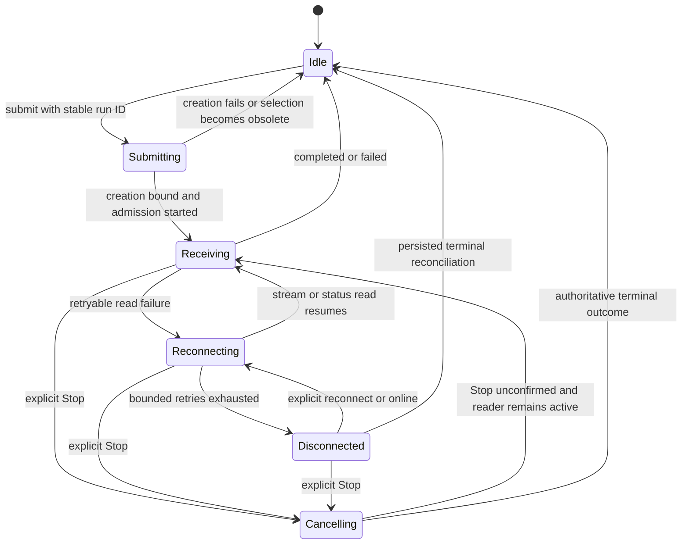

# FE-07 chat lifecycle transitions

## Status

Implemented and locally validated. Exact-source CI and frontend/API publication
remain pending. The currently live source remains `c72702e` until the deployment
evidence below is completed. No library, endpoint, schema, quota, model policy,
checkpoint format or persistence migration changed.

## Behavior and ownership

- `chat-lifecycle` distinguishes idle, submitting and running. Submission holds
  its run ID before awaiting conversation creation. Admission, creation binding
  and completion require that same ID. Result unions distinguish an answer from
  a comparison; pending/cancelled turns cannot carry a completed response.
- `answer-lifecycle` separates receiving, reconnecting, disconnected, cancelling
  and idle. Draft/source previews survive reconnection. Terminal/detached runs
  ignore late updates; one run cannot settle or append to a newer one. No state
  machine dependency is added; React and native typed transitions are sufficient.
- Saved creation retains its draft ID after an uncertain response. A selection
  epoch rejects completion after navigation/selection/unmount, before selecting
  the created record or starting a model. Creation binds the conversation ID
  before its own selection renders. A created empty conversation may remain on
  the server after navigation; it is neither deleted automatically nor executed.
- Sending is visible and guarded synchronously against repeated submissions.
  SSE event sequence validation remains in the existing shared reader. Known
  admissions recover with reads only; only unknown admission may retry the same
  stable ID. An online event after terminal completion cannot restart a run.
- Explicit Stop coalesces and displays a disabled pending action for both modes.
  A concurrent reader terminal is retained while the authorized Stop response
  decides cancellation versus completion. If Stop cannot be confirmed, the UI
  says so and continues the existing execution. Navigation detaches the reader;
  it does not send a cancellation or silently submit another question.
- FE-06 incremental visited-history merging, cursor validation, old feedback,
  backscroll preservation, finite metadata reads and exclusive SSE/HTTP/comparison
  readers are retained. Private scope, citation validation, server authorization,
  provider cancellation/budgets and raw-content log policy are unchanged.

## Transition map

Cancelling preserves the last connection phase and draft. If cancellation is not
confirmed, recovery uses that phase; the diagram's Receiving arrow abbreviates
that restoration. A terminal outcome is retained in the transcript. Detachment
returns local transport/control to idle without cancelling server work. Every
non-detach event is checked against its execution ID before applying it.

## Local evidence

- Nine strict compile-time negative assertions reject impossible result/lifecycle
  assignments without emitting runtime test code into the product bundle.
- Two pure lifecycle cases, five window cases, eight new browser lifecycle cases
  and ten FE-06 browser cases pass in three profiles: **75 focused checks**.
  Fixtures use synthetic records; no provider, private document or email is used.
- Cases include uncertain creation plus rapid submit; creation/selection and
  route overlap; duplicate/replayed SSE event IDs and cursor continuity; online
  after terminal completion; unknown-admission same-ID retry; unconfirmed Stop
  for answer and comparison; and a delayed completion racing Stop. One ordered
  conversation/run is retained in the submission fixtures.
- The seven-check local harness passed: strict checks, existing API unit suite,
  production builds, injection suite, golden set, replay regression and local
  Promptfoo. Performance benchmarking remains a separate ticket; there is no
  invented historical spend/latency measurement.
- The architecture gate reports zero violations and all 78 fixtures passed.
  Existing responsive screenshots and thresholds remain unchanged.

## CI and publication evidence

Pending exact-source checks, deployment IDs, public health/protected-route smoke
checks and a bounded application error-log inspection. Local fixture success
alone is not a claim of a real authenticated production conversation test.
