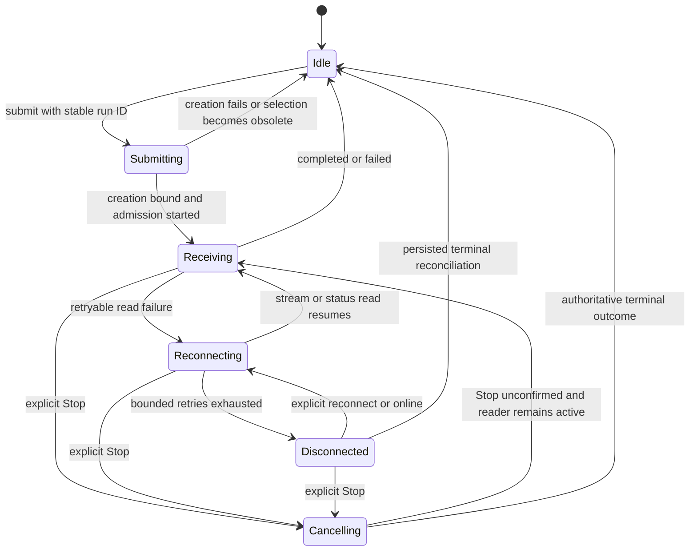

# FE-07 chat lifecycle transitions

## Status

**Frontend and API are live** at `fe9449b8da7bf9e6b1ee37133f3f27f47698ef58` after all four
[exact-source CI gates](https://github.com/willianmesko/rag-study-mvp/actions/runs/42412334616) passed.
FE-07 is complete. The source push explicitly skipped automatic publication;
manual deployment followed CI approval and fresh queue/remote-head checks.
No library, endpoint, schema, quota, model policy, checkpoint format or persistence
migration changed.

| Service | Deployment | Observed live at UTC |
| --- | --- | --- |
| API | `dep-dbnoth0u01pc73dbiaq0` | 2026-11-07 20:49:51 |
| Frontend | `dep-dbnotjm417fc73ebn67g` | 2026-11-07 20:50:08 |

## Behavior and ownership

- `chat-lifecycle` distinguishes idle, submitting and running. Submission holds
  its run ID before awaiting conversation creation. Admission, creation binding
  and completion require that same ID. Result unions distinguish an answer from
  a comparison; pending/cancelled turns cannot carry a completed response.
- `answer-lifecycle` separates receiving, reconnecting, disconnected, cancelling
  and idle. Draft/source previews survive reconnection. Terminal/detached runs
  ignore late updates; one run cannot settle or append to a newer one. No state
  machine dependency is added; React and native typed transitions are sufficient.
- Saved creation retains its draft ID after an uncertain response. A selection
  epoch rejects completion after navigation/selection/unmount, before selecting
  the created record or starting a model. Creation binds the conversation ID
  before its own selection renders. A created empty conversation may remain on
  the server after navigation; it is neither deleted automatically nor executed.
- Sending is visible and guarded synchronously against repeated submissions.
  SSE event sequence validation remains in the existing shared reader. Known
  admissions recover with reads only; only unknown admission may retry the same
  stable ID. An online event after terminal completion cannot restart a run.
- Explicit Stop coalesces and displays a disabled pending action for both modes.
  A concurrent reader terminal is retained while the authorized Stop response
  decides cancellation versus completion. If Stop cannot be confirmed, the UI
  says so and continues the existing execution. Navigation detaches the reader;
  it does not send a cancellation or silently submit another question.
- FE-06 incremental visited-history merging, cursor validation, old feedback,
  backscroll preservation, finite metadata reads and exclusive SSE/HTTP/comparison
  readers are retained. Private scope, citation validation, server authorization,
  provider cancellation/budgets and raw-content log policy are unchanged.

## Transition map

Cancelling preserves the last connection phase and draft. If cancellation is not
confirmed, recovery uses that phase; the diagram's Receiving arrow abbreviates
that restoration. A terminal outcome is retained in the transcript. Detachment
returns local transport/control to idle without cancelling server work. Every
non-detach event is checked against its execution ID before applying it.

## Local evidence

- Nine strict compile-time negative assertions reject impossible result/lifecycle
  assignments without emitting runtime test code into the product bundle.
- Two pure lifecycle cases, five window cases, eight new browser lifecycle cases
  and ten FE-06 browser cases pass in three profiles: **75 focused checks**.
  Fixtures use synthetic records; no provider, private document or email is used.
- Cases include uncertain creation plus rapid submit; creation/selection and
  route overlap; duplicate/replayed SSE event IDs and cursor continuity; online
  after terminal completion; unknown-admission same-ID retry; unconfirmed Stop
  for answer and comparison; and a delayed completion racing Stop. One ordered
  conversation/run is retained in the submission fixtures.
- The seven-check local harness passed: strict checks, existing API unit suite,
  production builds, injection suite, golden set, replay regression and local
  Promptfoo. Performance benchmarking remains a separate ticket; there is no
  invented historical spend/latency measurement.
- The architecture gate reports zero violations and all 78 fixtures passed.
  Existing responsive screenshots and thresholds remain unchanged.

## CI and publication evidence

The final CI passed **349 UX-suite cases with 44 deliberate profile skips**;
83 real PostgreSQL cases and one isolated embedding cutover with zero skips;
78 architecture fixtures; zero violations in both structural/runtime graphs;
and all seven harness checks. No screenshot baseline or threshold was relaxed.

The structural graph covered 442 modules/1,736 dependencies; the runtime graph
covered 441/1,245. Nine compile-time invalid-state assertions ran with the strict
web check. Both Render records report the exact approved source SHA above.

Public checks at **20:50:36 UTC** confirmed frontend HTTP 200, entry
`/assets/index-C0ee3qG6.js` and lifecycle chunk
`/assets/WorkspaceSwitcher-BQzDNiRt.js`. The latter includes the creation selection
guard and new sending/unconfirmed-comparison-Stop copy. Recovery/response-decoding
markers and the source-matching 256-pixel PNG icon remain present.

API health returned 200 with OCR, durable workflows and conversations active,
and server-controlled request correlation. Private conversation, MCP and alert
routes returned 401 without credentials. OAuth resource discovery/S256 remained
intact; malformed JSON, unsupported MIME and missing authorization parameters
were rejected with sanitized errors.

The API application error/fatal query for **20:49:51–20:50:43 UTC** returned no
records. This is a bounded inspected window, not a long-term availability claim.
No real conversation, private document, provider call, notification or third-party
consent/grant was used in the public checks. Authorized behavior is covered by
synthetic browser flows and isolated PostgreSQL tests; a real authenticated
production conversation was not manually exercised.

Previous verified runtime: `c72702e198064fb9e1ea562ee3a7790c3026c843`.
The release is compatible with that runtime's database and API contracts.
