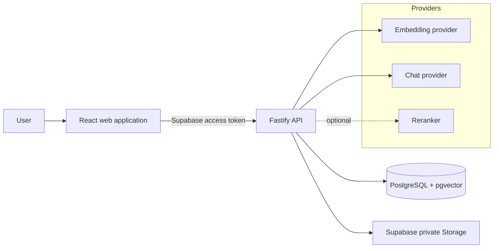
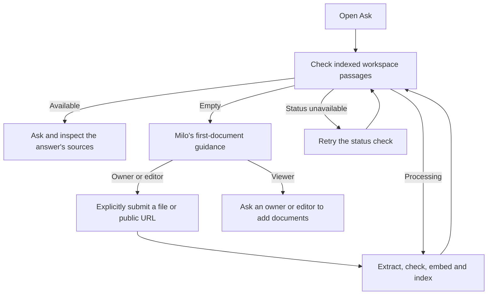
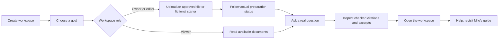
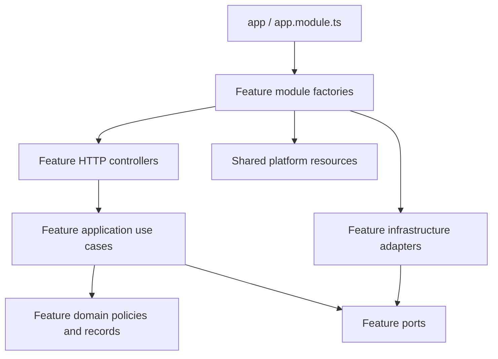
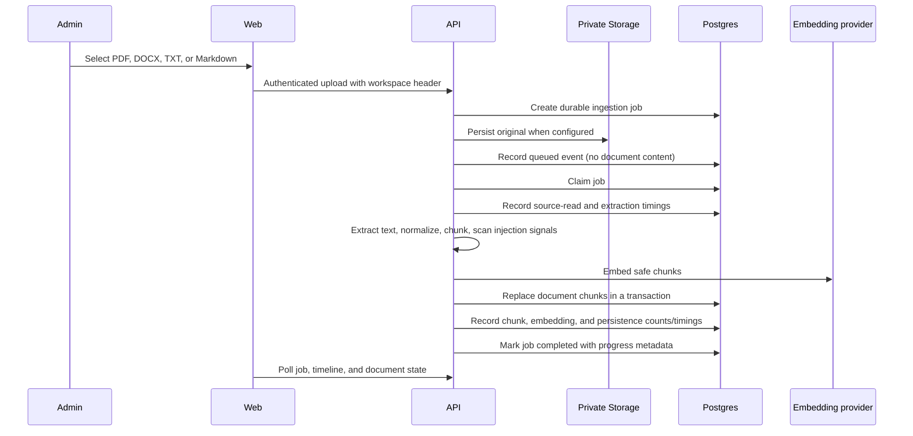
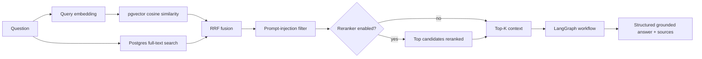
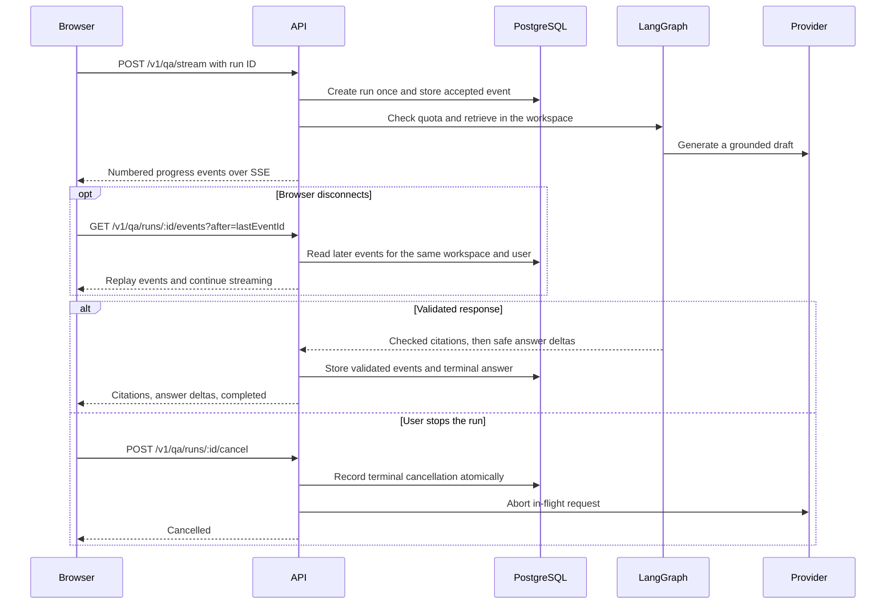
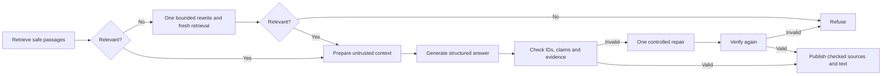
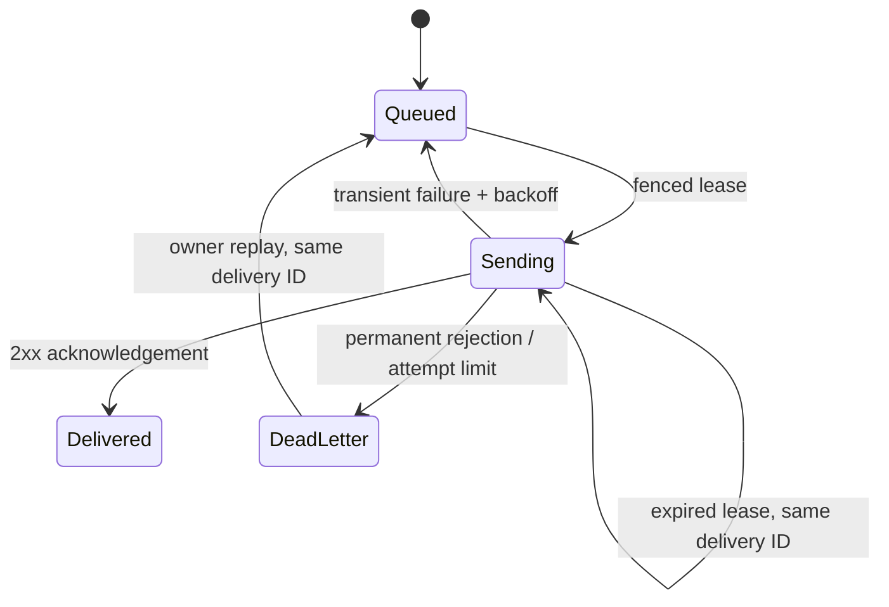

# System Architecture

## Purpose

Lumora is a knowledge workspace for teams across industries. Each workspace
holds the documents its members use to search, learn, support others, and
answer questions with sources. The same ingestion, retrieval, and authorization
model applies to handbooks, procedures, FAQs, product guides, and project
materials. IT and legal scenarios are optional study examples.

Its retrieval-augmented generation architecture makes the path from document
to context to answer visible. Retrieval, ranking, security checks, and provider
adapters can each be inspected and replaced independently.

## System boundaries



The browser is an untrusted client. It receives only public configuration,
short-lived Supabase sessions, answers, and sources permitted by the API. It
never receives database credentials, provider keys, a service-role key, or an
administrative API key.

## Frontend information architecture

The private workspace is a routed control center rather than one long
administration screen:

```text
/workspace/overview       → workspace pulse and next actions
/workspace/knowledge      → sources, upload, filters, chunks, reindex/delete
/workspace/processing     → ingestion timeline, retries, and stage errors
/workspace/team           → invitations, members, and roles (owner)
/workspace/evaluations    → golden-set quality and safety runs (owner)
/workspace/usage          → model-level usage and recorded costs (owner)
/workspace/settings       → workspace identity and policies (owner)
```

Global navigation places the active workspace above the page links, in the
desktop sidebar and the compact top navigation on smaller screens. Its menu
lets signed-in users switch workspaces or create another one. A newly created
workspace starts its own onboarding. Each route mounts the
section that owns its data, actions, and loading and error states. The
onboarding guide explains concepts in plain language and links directly to
the next action.

Workspace sections use compact text navigation and one page heading with the
primary action. Overview shows a single metric strip, actionable alerts, and
recent activity. Documents and members use divided lists with action menus.
Invitations and adding documents open in dialogs. Selecting a document opens
a side panel with metadata, original-file controls, and passages. Processing
loads its detailed timeline for the selected file. Settings groups use dividers
and expandable model and assistant controls.

Invitation access is a native radio group with Viewer and Editor visible inside
the modal. Viewer is selected by default, descriptions are associated with
each input, and the group is disabled while sending. This works in the Team
dialog, initial onboarding and the nested Milo Help guide. The invitation API,
owner authorization and workspace scope keep the existing contract.

This invitation-control revision was published on 2026-11-07 as frontend commit
`344ab76169a3f469db5d4a8eb335b2c7865c67e2`, deploy
`dep-dbng6gbm8hqs73c4je10`. All three
[release quality gates](https://github.com/willianmesko/rag-study-mvp/actions/runs/42365583647)
passed. Targeted validation covers twelve responsive cases plus eight desktop
WebKit/Firefox cases, with native keyboard selection, pending-state protection,
nested dialogs, focus return and accessibility. Published English/Portuguese
browser checks used isolated session/member API fixtures; real email delivery
was not exercised. Served assets and the unchanged API's health were verified.

The desktop Ask surface fills its content column and the remaining viewport
height. The message thread keeps a readable line width inside that surface.

Ask is the first navigation destination. Page links use descriptive labels and
icons without step numbers. Normal sign-in and completed onboarding open `/ask`;
an authorized explicit deep link still returns to its own section. The public
`/demo` entry opens Ask, with search available at `/demo/search`. The app mark
and favicon share one SVG asset: open pages with a point of light.

Before enabling a fresh question, chat reads `GET /v1/knowledge/status`. The
application read-model port returns counts from the actual workspace index and
all ingestion jobs in a single PostgreSQL snapshot, independently of paginated
admin lists. Empty document rows do not unlock chat. The response contains only
indexed-document, passage, pending-job and failed-job counts. Private requests
must provide an explicit workspace, verified membership, and a valid session;
viewers can read readiness. Anonymous demo requests are limited to the configured
public corpus and cannot supply a tenant override. The existing API rate limit
and no-store headers apply. No new tables, grants or RLS exceptions are required.

An empty index shows Milo's document-first guidance instead of a composer or
unsupported question suggestions. Owners/editors can explicitly add a file or
public URL through the same protected intake dialog used by Knowledge. Selecting
a file does not enqueue it; submitting does. Viewers are directed to an owner or
editor. Processing is polled every three seconds while visible; indexed content
unlocks the composer automatically without submitting a question. Ready indexes
refresh every 15 seconds, and local upload/delete/reindex actions invalidate the
scoped query. Each chat entry waits for a fresh status so cached counts cannot
briefly unlock a deleted library. A readiness error offers retry and blocks new submission. Existing
messages and active-run cancellation survive an availability change. These UI
guards complement server authorization and evidence checks; an available index
does not guarantee relevant evidence or a factually correct answer.



This navigation/readiness release was verified on 2026-11-07 for commit
`3f60bbf95d49d17a666f63284ae386196f006fbb`. All three
[release quality gates](https://github.com/willianmesko/rag-study-mvp/actions/runs/42364069688)
passed, including 24 PostgreSQL integration checks and 99 applicable browser
checks. The API deploy `dep-dbnfsd3rjlhs738mro2g` and frontend deploy
`dep-dbnftt49v7es73cm0gng` were confirmed live. Public HTTP checks verified
readiness counts, no-store headers, rejected tenant overrides, private-route
authorization and the served SVG's checksum. Desktop/English and
mobile/Portuguese production browser checks verified automatic locale,
Ask-first navigation, the empty-library experience and no automatic question
calls. No new API errors were recorded during verification. Signed-in
upload/prepare/ask and cache invalidation journeys use isolated API fixtures;
the SQL implementation is exercised against real disposable PostgreSQL.

Onboarding is organized around goals such as finding team knowledge, supporting
others, and learning from documents. Each goal offers a reusable fictional
Markdown starter in English or Portuguese, a download/preview, and grounded
suggested questions. Uploading a starter is an explicit action through the same
authorized ingestion endpoint as a personal file; choosing a goal alone never
uploads content or calls a provider. Knowledge also offers three bilingual,
versioned demonstration libraries with fictional handbooks, procedures, FAQs,
product guides, and project briefs. Questions name their supporting sources.
Only an owner or editor can explicitly enqueue the bundled documents. The API
selects the content from its catalog, applies upload quotas and audit events,
and uses a short workspace lock to deduplicate source imports. Existing
documents are preserved. The normal worker extracts text, scans, embeds, and
persists each accepted file. Viewers can preview materials and ask questions
once the supporting sources are indexed.

Document filters are shared Zod contracts and bound PostgreSQL predicates.
Workspace scope, document/source text, language, format, and inclusive UTC
updated-date bounds apply before the 100-result limit. Request logs retain
the method and route pattern, excluding filter values and request content.

The guide retains the three persisted phases (`purpose`, `knowledge`, `answer`)
so earlier progress and concurrent-device completion remain compatible. Its
document phase follows actual queued/processing/completed records and refreshes
the document list after preparation. Owners can use the shared invitation
feature; editors can upload; viewers inspect available documents and ask questions.
Naming guidance, data-handling notes, and expandable plain-language definitions
explain passages, embeddings, retrieval, citations, and similarity.



The practice question uses the existing workspace Q&A, model allowlist, SSE,
quota, cancellation, and citation-validation paths. Guide runs have a distinct
browser replay scope so opening Help cannot attach the main chat to the same
run. Navigation/closing is blocked during an active guide upload or answer,
with the existing Stop control available for answers. Signed-in practice
questions use the same private, durable product history as the main chat.
The guide does not change the main chat's selected conversation URL.

Help opens a local replay of the guide without resetting the saved goal,
furthest phase, or completion. It clearly identifies uploads, questions, and
invitations as real actions. Finishing setup early is supported, with a visible
reminder that the guide remains available from Help. Live invitation delivery
still depends on the configured authentication sender.

Milo's onboarding state belongs to the authenticated workspace membership.
The API stores the selected goal, furthest step, and completion. Database
updates keep the furthest step and preserve completion when two devices
submit in either order. The browser keeps a scoped copy for retry and
imports earlier browser-only progress when the user returns.

## Monorepo and ownership

```text
apps/web                 React feature-sliced UI and browser-safe API client
apps/api                 HTTP boundary, use cases, infrastructure adapters, CLI
packages/contracts       Zod schemas shared between web and API
```

`packages/contracts` owns request-shape validation shared across application
boundaries. The API still owns authorization and every server-side invariant.
Type sharing does not make the browser a trusted source.

### Architecture review and incremental plan, 2026-11-07

Parallel source reviews of frontend and backend at `e25572d` support retaining
the current stack and modular API. They do not establish throughput or complete
FSD enforcement. The [technical backlog](technical-backlog.md) contains the original
25 implementation tickets plus the owner's BE-15 abstraction follow-up, with
current progress, evidence and alternatives in the
[frontend review](frontend-architecture-review.md) and
[backend review](backend-architecture-review.md).

The review described the source at `e25572d`, before implementation. The first
published batch adds credential-free user/workspace cache keys, JSON/error
transport, UI recovery boundaries, safe native HTTP errors, idle-pool fault
handling, stable key inventory, full-window alert repair and a cutover CI gate.

The next source batch moves frontend routing/session composition into `app`, adds
shared success-response decoding, explicit slice Public APIs and a development-only
dependency gate. Backend changes add bounded identity/directory access, workload
SQL deadlines, narrow controllers/factories and shutdown/budget safeguards.
Publication status and verification evidence are maintained in the technical
backlog rather than inferred from the presence of code.

The backend is organized by business modules following
[ADR 0002](decisions/0002-business-modules.md), with a concrete
[module guide](backend-modules.md). The subsequent
[capability-boundary decision](decisions/0003-technology-neutral-modules.md)
moves technology selection into `app/composition`: module factories receive
repository/provider/workflow/tracing ports and plain options, without concrete
SDKs or database clients. The registry is backend-owned and read-only to business
code; current public model allowlists, embedding-index constraints and persisted
workflow versions are preserved. Replacement requires tested capability and state
compatibility. The frontend remains `app` → pages → widgets
→ features → entities → narrow shared segments. Not every slice needs every
segment. The approved graph checker is a development tool; application frameworks
and runtime dependencies are preserved.

[ADR 0003](decisions/0003-technology-neutral-modules.md) records the next explicit
request: module assembly receives tool-neutral capability ports, while outer
composition selects PostgreSQL/provider/graph/tracing adapters. Its implementation
and release status are separate from the first module-organization delivery.

## API architecture

The API is a modular monolith with NestJS-inspired feature organization and
native Fastify controllers/factories. Clean Architecture boundaries apply inside
each business module. Technical resources live under `platform`; overall
composition lives under `app`.



- **Modules** group Identity, Workspaces, Knowledge, Ingestion, Chat, AI,
  Evaluations, MCP, Usage and product Workflows.
- **Domain/policy** contains pure rules without HTTP, database or SDK dependencies.
- **Application services** implement use cases such as ingesting a document, searching,
  answering a question, queueing uploads, and managing members.
- **Ports** describe capabilities such as embedding, retrieval, file storage,
  quotas, audit events, and answer generation.
- **Infrastructure** adapts PostgreSQL/pgvector, Supabase Storage, Ollama,
  OpenRouter, Bedrock, Jina, LangGraph, and LangSmith to those ports.
- **Controllers** translate HTTP input into authorized application calls.
- **Module factories** assemble related providers from explicit resources/config.
- **Application composition** connects exported capabilities and owns lifecycle.
- **Platform** contains shared SQL/transport/security/execution facilities.

This separation allows a model provider to be changed without rewriting a use
case, and enables deterministic fakes in tests.

## Ingestion flow



Chunking limits the amount of text sent to an embedding model and creates
retrieval units. A small overlap preserves ideas spanning chunk boundaries.
Chunk size and overlap are quality and cost trade-offs, not universal constants.

The same source can be re-ingested. Embeddings are generated before the storage
transaction so a provider failure cannot erase the last indexed document.

The ingestion timeline stores operational facts only: stage, status, timestamp,
duration, and safe numeric counts such as characters, chunks, or vectors. The
document text and original file remain outside the event stream.

## Retrieval and answer flow



Hybrid retrieval combines two complementary signals:

- Vector search handles semantic similarity, including paraphrases.
- Full-text search handles exact terms, identifiers, and rare vocabulary.
- Reciprocal Rank Fusion merges rank positions without assuming scores from the
  two retrieval methods are comparable.
- An optional reranker reads a limited set of candidates and improves ordering
  before the LLM receives the final context.

The displayed retrieval score is a relative relevance signal, not a probability
or a guarantee that an answer is correct. The UI exposes sources so users can
inspect the evidence.

## Streaming answer flow



Authenticated Server-Sent Events (SSE) use a client-generated UUID and numbered
events. Admission is idempotent per workspace and user. A duplicate start or
reconnect reuses the existing run and does not consume question quota again.
Every replay and cancel request revalidates membership. A server-side stop
aborts local calls immediately and reaches a run on another replica through its
next status check. The state transition and terminal event commit together.

The server buffers the provider draft until it has checked the structured
answer and the citation identifiers. Fresh checked citations precede safe text
deltas. Reused or unstructured answers arrive in the terminal response with the
appropriate evidence status. The private replay tables retain progress and the
answer for up to 24 hours. With durable workflows enabled, native checkpoints
restore unfinished work after a worker restart within the original deadline.
They do not hold raw questions or raw provider drafts. Anonymous demo streams
are transient. The JSON endpoint is available as a fallback before a streaming
run is admitted.

Saved conversations use server-owned context: up to three successful recent
questions from the same private conversation, with a 500-character bound on
each. The browser submits the conversation and execution UUIDs, not trusted
history. The server redacts personal data, screens context for prompt injection,
retrieves fresh workspace passages, and validates citations. Saved conversations
bypass shared semantic answer caching, including the first turn. Anonymous demo
questions remain standalone. Comparisons preserve two answers in one private
turn, using the same retrieved evidence for both models/prompts.

### Durable conversation history

`conversations` is keyed by workspace, owner, and conversation UUID. Each
`conversation_turns` row owns an ordered user/assistant pair with durable message
IDs, canonical input, status, checked citations, model and usage metadata, and
optional feedback. Each read and mutation verifies current membership and
conversation ownership. Workspace owners cannot read another member's history.

Admission locks the conversation, checks an immutable request hash, and creates
one queued pair. That queued record is an admission outbox: a retry or recovery
reuses the run UUID and does not reserve another quota unit or provider call.
A database trigger commits normal chat's checked reply in the same transaction
as its terminal replay event. Comparison admission is durable; an uncertain
in-flight comparison after a server restart becomes interrupted at its deadline
rather than silently calling providers again.

Lists use timestamp/UUID keyset pagination and messages use ordered sequences.
Named conversations reopen across signed-in devices. They expire 90 days after
the last submitted message. Deletion cascades through product turns and linked
replay/workflow state; membership removal deletes that member's private history.
Expired content is inaccessible before bounded background cleanup. Backups
retain the hosting provider's separate lifecycle.

Operational logs, audit events, and optional tracing summaries exclude raw
questions and document passages. RLS and revoked Data API grants keep these
records behind backend authorization. See [Durable conversations](durable-conversations.md)
for the schema, sequence diagram, endpoints, deletion rules, and verification.

Native encrypted PostgreSQL LangGraph checkpointers now persist graph execution
state for authenticated chat, ingestion, evaluations, and owner approval. That execution state has a separate
lifecycle from the user-facing history. The underlying patterns are described
in the [durable-workflow guide](durable-workflows.md),
the [LangGraph persistence guide](https://docs.langchain.com/oss/javascript/langgraph/persistence)
and the [AI SDK message persistence guide](https://ai-sdk.dev/docs/ai-sdk-ui/chatbot-message-persistence).

## Workspace MCP boundary

Five read tools share Zod schemas across local stdio and remote HTTP clients.
The local bridge uses a temporary credential and explicit workspace. Remote
clients connect to `/mcp`, discover the protected resource and authorization
server, register a public client, and use authorization code + S256 PKCE.
Supabase login stays inside Lumora's first-party consent screen. The member
explicitly chooses one workspace and a subset of tools; the assistant receives
separate, audience-bound opaque access and rotating refresh tokens. Only their
SHA-256 digests are stored. Members manage their own grants at `/connections`,
including viewers and accounts that have not completed onboarding.

Every call checks current membership, the consented allowlist and role ceiling.
PostgreSQL coordinates rates, provider reservations, daily user/workspace spend
bounds and concurrent searches across API instances and credential rotations.
Search makes exactly one PII-redacted query embedding against the pinned,
explicitly priced active index, then combines bounded pgvector and full-text
candidates with Reciprocal Rank Fusion. Missing/unpriced indices fail closed;
MCP never pins, migrates, reindexes, generates answers or invokes a reranker.
The configured price and UTF-8 token upper bound provide conservative budget
accounting, not a claim of measured provider billing.

A separate two-connection pool runs fixed read-only PostgreSQL transactions
with two-second statement limits. Remote exchanges have an eight-second
deadline; local tool calls have five seconds. Disconnects, protocol
cancellation, grant revocation and membership changes propagate abort signals
to embeddings and reads; durable cancellation guards are polled every 250 ms.
Screened, capped excerpts remain untrusted data. Source text, queries, codes,
verifiers and tokens stay outside audits. Authorization and accounting writes
use the control connection, rather than weakening the business-data read-only
boundary. Host and Origin allowlists, no-store responses, iframe denial and
mandatory audit completion protect the remote transport and consent flow.

Approved evaluation actions use a separate owner-authenticated proposal and
approval API. A dedicated worker claims fenced leases, performs a fixed
provider-free evaluation, and commits its report and completion event
atomically. Future action handlers require effect-specific policies.
See the [MCP guide](workspace-mcp.md) for the transport, limits, and runnable
configuration.

## LangGraph workflow

The workflow expansion covers seven capabilities: adaptive retrieval, claim
verification/repair, checkpointed ingestion, unified evaluation, durable owner
approval, shared persistent resource guards, and restart recovery.



Ingestion and evaluation are separate native graphs. The admission record,
checkpoints, pending writes, provider effect journal, persistent reservations,
and fenced worker leases share the existing PostgreSQL database. Automatic
content tracing is suppressed for durable executions. Owner-approved evaluation
pauses survive service restarts. Cancellation propagates to model calls and OCR
processes; late mutations require a current lease and authorization.

See [Durable LangGraph workflows](durable-workflows.md) for every graph, the
model/code responsibility split, database isolation, budget accounting,
publication semantics, recovery bounds, deployment, tests, and failure runbooks.
The free deployment still needs capacity measurement before scaling; execution
recovery is not evidence of throughput capacity.

## Security model

| Risk | Control |
| --- | --- |
| Prompt injection inside documents | Deterministic scanner, untrusted-context delimiters, high-risk chunk exclusion |
| Cross-workspace access | Tenant ID derived from validated membership, mandatory repository filtering |
| Unauthorized writes | Supabase session verification plus `owner`/`editor` role checks |
| Browser secret leakage | Provider, database, service-role, and admin keys remain server-only |
| Cost abuse | Tenant question quota, administrator upload-byte quota, compact audit trail |
| Unsafe LLM output | Zod contracts and server-side citation validation |

The scanner is not a complete defense. It reduces exposure and provides a testable
signal; authorization, least privilege, safe tool policies, and evaluation are
separate controls.

## Identity and tenancy

Supabase Auth identifies the signed-in user. For workspace-scoped calls, the
API validates the bearer token and resolves the role for the `X-Workspace-Id`
membership. An account with several memberships must select one explicitly.
Routes that allow implicit selection use it only when exactly one membership
exists. Creating a workspace assigns its creator the `owner` role there.

Model selection and comparison require a verified membership and explicit
workspace. The API resolves client model aliases from its configured list.
Owners can further narrow that list and choose a default for their workspace.
Auto routing uses a deterministic complexity rule and a configured fallback
order. It reserves a conservative prompt-token bound, output caps, estimated
cost, and quota before each planned attempt. It publishes citations and text
only from the final successful model and records each attempt's usage provenance.
Comparison reserves two quota units atomically, prepares a single set of
passages, and checks the combined generation budget before contacting either
model. Semantic answer cache entries are isolated by workspace, model,
prompt version, and retrieval limit. Comparison does not reuse cached answers.
Controlled comparisons vary exactly one dimension: two allowed models use the
same prompt, or one allowed model uses two approved prompt styles. Balanced,
Concise, and Explanatory are versioned backend policies with the same trusted
grounding and structured-output contract. Each result records its prompt,
provider/model, token-usage provenance, latency, estimated cost, and validation
outcome. Browser exports exclude the question, answer, and source excerpts.

- **owner**: manage members, invitations, the corpus, and workspace settings.
- **editor**: manage the workspace corpus.
- **viewer**: browse documents and processing, search, and ask questions.

All document, chunk, job, quota, and audit operations are tenant-scoped. The
frontend stores a selected workspace only as a convenience; it never establishes
authorization on its own.

## Evaluation and observability

The repository contains three complementary quality layers:

1. **Unit tests** for domain logic and use cases.
2. **Golden set** for deterministic retrieval regression metrics such as hit rate
   and MRR.
3. **Prompt-injection suite and Promptfoo** for security regression coverage.

The workspace retrieval evaluator expects the reviewed reference source
`golden/rag-fundamentals`, matching `examples/rag-fundamentals.md`. Its preflight
blocks a run before retrieval or judge calls when that source is absent. Owners
can explicitly prepare the bundled reference from Evaluations; historical runs
remain unchanged. A score of 4/4 cases means coverage, not four correct answers.
Faithfulness and judge calibration currently use separate public fixtures, so
their scores do not certify the selected workspace's own documents. Dataset
mapping and reviewed private-corpus evaluations remain future work. See
[Demonstration and discovery](demonstration-discovery.md).

LangSmith tracing is optional and disabled by default. It should be enabled only
after deciding what content and metadata may leave the system. A future
production deployment can use LangSmith or an OpenTelemetry-compatible platform,
not both by default.

### What Promptfoo does

Promptfoo is a test runner for LLM prompts and providers. It executes a matrix of
inputs, sends them to a configured provider, evaluates assertions, and returns a
non-zero exit code when a case regresses. This repository uses a local provider
that calls the deterministic prompt-injection scanner, so the default CI check
does not transmit document text, prompts, or secrets to a hosted model.

### Structured output and Zod status

Zod validates inputs throughout the API, and `packages/contracts` shares many
wire schemas. Shared coverage is not complete: some route DTOs and client
response assumptions remain local and are tracked in BE-12/FE-02. The LangGraph
boundary asks providers for
a JSON answer with `answer`, `citedChunkIds`, and `refusalReason`, parses it with
Zod, and verifies the short source labels (`S1`, `S2`) against the passages
included in the prompt. The API maps those labels to database chunk IDs after
validation. This keeps internal IDs outside the prompt and its PII redaction
step. Structured answers must include a valid citation, and refusals are not
cached. Plain-text local models remain available as an unstructured fallback
that production can disable.

Fresh successful answers return separate lists for validated citations and
the passages included in the model's context. The workflow redacts full
passages before applying the context budget. HTTP and SSE use the same
600-character excerpt policy for the UI. Reused answers show saved passages,
and the new context list is excluded from the semantic cache and tracing.

### Agent safety boundary

The current workflow is still a bounded RAG agent rather than a general-purpose
tool-using agent. Its safety policy is explicit:

| Model may decide | Code must enforce |
| --- | --- |
| How to phrase a grounded answer | Tenant scope and RBAC |
| Which retrieved evidence is relevant | Prompt-injection filtering |
| Whether to express uncertainty | Citation allowlist |
| Whether a refusal is appropriate | Step, token, time, and cost budgets |

Read-only workspace tools are defined as an allowlist, but no write-capable tool
is exposed yet. Actions that mutate data, contact external systems, or execute
code will require an approval checkpoint before they are added.

## Deployment profile

The economical demonstration profile is:

```text
Render static site  →  Render API  →  Supabase Postgres/Storage/Auth
                                       ↘ OpenRouter when hosted models are needed
```

The frontend publishes `apps/web/dist`; the API builds from the repository root
with `apps/api/Dockerfile`. Configuration is supplied by the hosting platform,
not committed files. The deployment guide lists the required variables and
acceptance checks. Supabase RLS policies allow authenticated workspace reads by
membership, while cache, quota, audit, and usage tables remain backend-only.

## Workspace usage analytics

The owner-only Usage & costs page reads the existing private `ai_usage_events` ledger through
`GET /v1/admin/usage?days=7|30|90`. Every read requires an explicit verified
workspace. The SQL bounds the scan with the existing `(tenant_id, created_at)`
index and uses one `GROUPING SETS` snapshot for totals, provider/model pairs,
operations, and UTC days. Other tenants and dates outside the rolling window
cannot enter a subtotal. Historical model identity is retained even if a model
is no longer allowlisted for new questions.

Recorded cost is the sum of each event's reported cost when present, otherwise
its saved estimate. It is not the sum of both figures. A reported zero is valid;
reported tokens alone do not imply a reported price. Model details distinguish
token and cost provenance, reuse, failed operations, average latency, and P95.
Answer latency covers its application operation, including retrieval and
validation. Additional provider-stage records measure their own invocation.
Operation averages/P95 can therefore combine different scopes; use the
operation breakdown and stage traces for diagnosis. Nested durations must not be
summed as end-to-end response time. One question may create
multiple comparison/routing operations. Cache rows have zero generation cost,
and no hypothetical savings figure is invented.

The interface offers model details, UTC daily amounts and a cost trend, operation
breakdowns, 7/30/90-day windows, and JSON export of allowlisted aggregate fields.
No prompts, excerpts, actor IDs, credentials, or individual event records are
exported. Reading analytics does not call a model. The overview alert uses its
30-day window; Usage & costs evaluates the same configured threshold for the chosen
window.

New ledger records also cover document/query embeddings, enabled reranking,
evidence judges, evaluation judges and evaluation generation. Provider-native
tokens/cost take precedence. A separately configured estimate is labeled as
such; operations without a known price are counted explicitly and do not become
fictional zero-cost measurements. Historical rows retain their earlier coverage
and saved amounts. The UI/export includes the start of expanded coverage.
Workflow budget reservations remain separate from accounting. See
[observability and cost operations](operations/observability.md).

The model-cost delivery passed all three
[release quality gates](https://github.com/willianmesko/rag-study-mvp/actions/runs/42361785953)
for commit `d5ab2092365c32bcb86aa50c219ca2dc3afbd82f`: the quality harness,
23 PostgreSQL checks, and 81 applicable responsive browser checks. Thirty browser
cases intentionally run only in their designated viewport. Owner journeys use
isolated API fixtures; reconciliation uses a real disposable PostgreSQL database.
The API (`dep-dbnfd7lg1s2s73cibneg`) and frontend
(`dep-dbnfep7f3r2c738go6p0`) were confirmed live on 2026-11-07. Health, protected
usage routes and deployed assets were verified, with no new API errors in the
inspected window. No production data or schema was rewritten.

## Next architectural increments

1. Complete the next [technical backlog](technical-backlog.md) batch: shared
   response schemas, SQL workload limits, bounded Auth/member lookup and app composition.
2. Use a release containing BE-04 for unattended budget delivery; select a
   tracing/metrics receiver and alarm routing under the existing data policy.
3. Use BE-01's logical-key inventory, then rehearse staged key rotation and backup
   restore before reader-key retirement. Old physical-cursor reports are insufficient.
4. Extract cohesive HTTP/application composition and frontend Public APIs with
   tested architecture gates; no additional framework is a prerequisite.
5. Validate mixed-workload capacity, connection budgets and tenant fairness.
   Separate ingestion workers only when measurements justify their cost.


### Simplified guided setup

The three persisted phases are unchanged. Each has one primary task. Upload is
shown first; the fictional sample is disclosed only on request. Actual progress
replaces the upload form, then one confirmation replaces progress. The first
question has one suggestion and a composer. Model/prompt comparisons stay in the
main chat; the complete glossary is in Help. Owners can invite teammates after a
grounded reply. Completing the guide passes its authorized conversation UUID to
Ask so the user can continue the same thread. Explicitly deferring setup saves a
valid goal/final-step completion record and leaves Help available.


## Resilient effects and operational signals

Uploads use workspace/actor-scoped idempotency and a request fingerprint. Byte
quota, job and queued timeline event commit in one PostgreSQL transaction. Stable
private original paths tolerate a lost upload acknowledgement through byte
verification. Ingestion admission has bounded delayed retries and does not claim
jobs already owned by an active workflow.

Workflow provider effects have a fenced journal: completed receipts are reused,
known rejected rate limits can retry within the original deadline/budget, and
uncertain paid calls are held for review. This avoids claiming distributed
exactly-once delivery. Budget notifications use a durable outbox, stable UUID,
HMAC signature, public pinned HTTPS egress, leased delivery, jittered retries,
dead letters and owner-authorized idempotent replay. Safe attempt events retain
audit history without source content.



Versioned AES-GCM envelopes separate active writer and retained reader keys. A
bounded rotation command now traverses immutable composite primary keys across
four encrypted stores, retaining authenticated conditional updates. Concurrent
relocation, heap rewrite and process-loss tests cover BE-01. Use this updated
implementation and the [activation gate](operations/workflow-key-rotation.md#current-activation-gate)
before reader-key retirement, along with backup-key custody. Earlier physical
cursor releases cannot prove completeness under concurrent updates.
OpenTelemetry spans trace
workflow stages, provider effects, tools and HTTP requests using server-generated
correlation IDs. Metrics use fixed bounded labels and distinguish reported,
estimated and unpriced cost. Logs/traces exclude content and credentials.

The optional local Collector/Jaeger/Prometheus/Grafana stack provides an operations
dashboard and tested alarm rules. No new hosted backend or external write tool
is automatically enabled. Read the [rotation procedure](operations/workflow-key-rotation.md)
and [effect/recovery policy](operations/integration-recovery.md) before operational
activation or registering a write-capable action.

The frontend and API are verified live at `a590360`; the
[phase 1 release record](operations/release-2026-11-07-architecture-phase1.md)
distinguishes four passing CI gates and production checks from pending operational
activation and later architecture work. Phase 2 source changes remain unpublished
until their own verification and release.

## NestJS/Fastify transition and Prisma pilot (2026-11-12)

The API candidate now boots through NestJS with its Fastify adapter. Nest owns
configuration, application factory providers and a pilot persistence module.
The native health controller coexists with current Fastify route plugins in an
encapsulated compatibility scope, preserving public paths and cross-cutting
security/streaming behavior. Most features are still awaiting native Nest
controller/provider migration; this is an incremental transition.

Prisma maps only the existing workspace model-policy table in this increment.
SQL migrations, RLS, pgvector retrieval and remaining SQL adapters are retained.
The API DI binding selects Prisma; standalone CLI/MCP compositions retain their
existing adapters. See the [decision, commands and safeguards](decisions/2026-11-12-nest-prisma-pilot.md).
