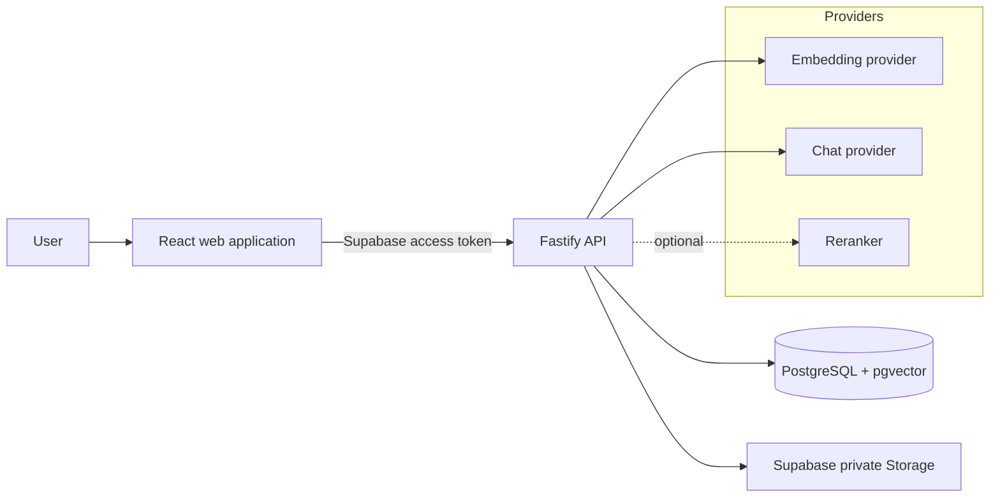
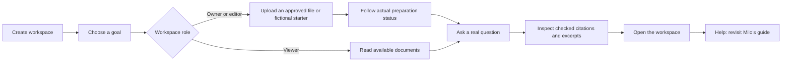
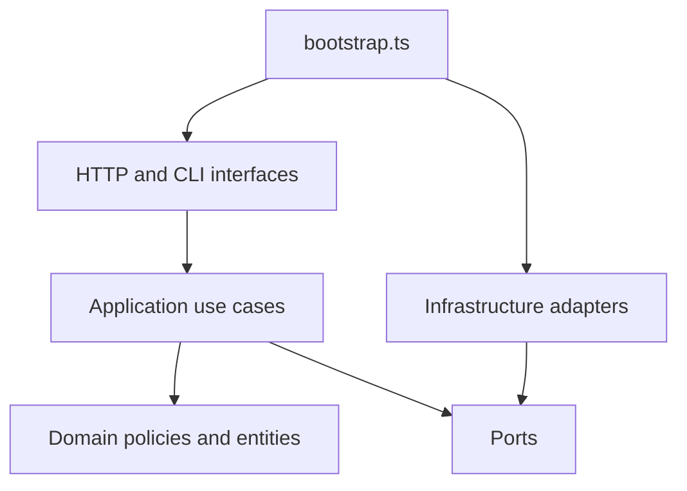
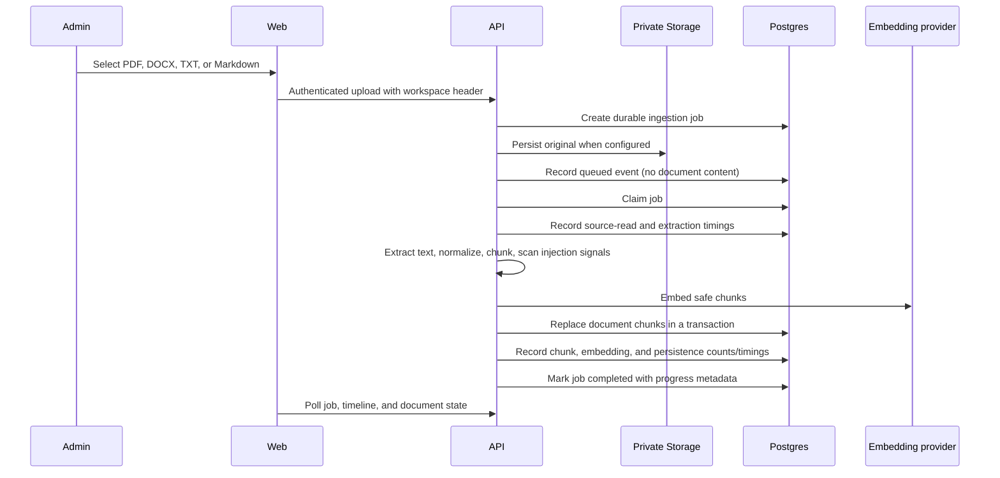
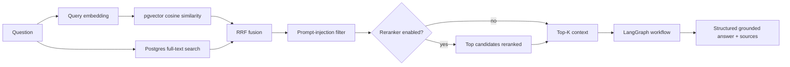
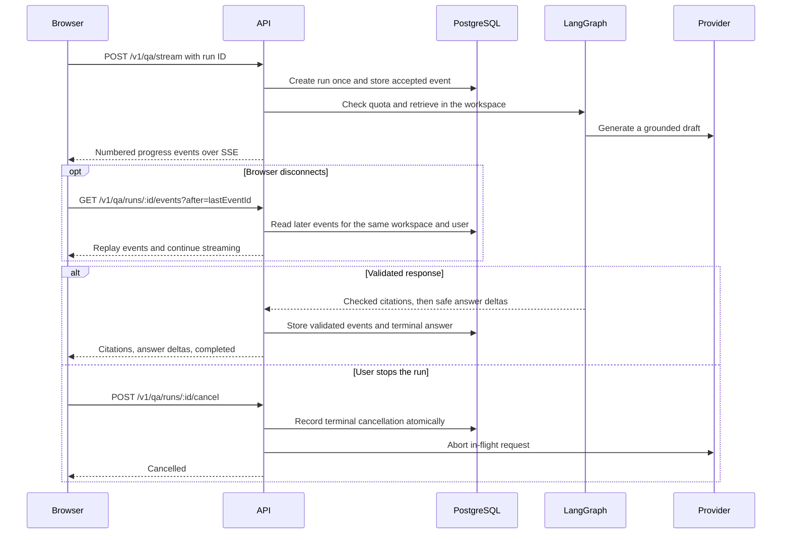
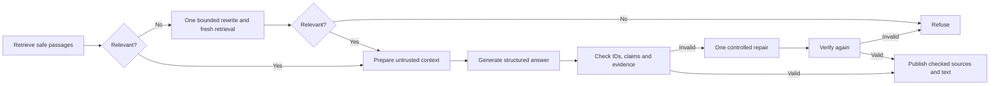

# System Architecture

## Purpose

Lumora is a knowledge workspace for teams across industries. Each workspace
holds the documents its members use to search, learn, support others, and
answer questions with sources. The same ingestion, retrieval, and authorization
model applies to handbooks, procedures, FAQs, product guides, and project
materials. IT and legal scenarios are optional study examples.

Its retrieval-augmented generation architecture makes the path from document
to context to answer visible. Retrieval, ranking, security checks, and provider
adapters can each be inspected and replaced independently.

## System boundaries



The browser is an untrusted client. It receives only public configuration,
short-lived Supabase sessions, answers, and sources permitted by the API. It
never receives database credentials, provider keys, a service-role key, or an
administrative API key.

## Frontend information architecture

The private workspace is a routed control center rather than one long
administration screen:

```text
/workspace/overview       → workspace pulse and next actions
/workspace/knowledge      → sources, upload, filters, chunks, reindex/delete
/workspace/processing     → ingestion timeline, retries, and stage errors
/workspace/team           → invitations, members, and roles (owner)
/workspace/evaluations    → golden-set quality and safety runs (owner)
/workspace/settings       → workspace identity, usage, and policies (owner)
```

Global navigation places the active workspace above the page links, in the
desktop sidebar and the compact top navigation on smaller screens. Its menu
lets signed-in users switch workspaces or create another one. A newly created
workspace starts its own onboarding. Each route mounts the
section that owns its data, actions, and loading and error states. The
onboarding guide explains concepts in plain language and links directly to
the next action.

Workspace sections use compact text navigation and one page heading with the
primary action. Overview shows a single metric strip, actionable alerts, and
recent activity. Documents and members use divided lists with action menus.
Invitations and adding documents open in dialogs. Selecting a document opens
a side panel with metadata, original-file controls, and passages. Processing
loads its detailed timeline for the selected file. Settings groups use dividers
and expandable model and assistant controls.

The desktop Ask surface fills its content column and the remaining viewport
height. The message thread keeps a readable line width inside that surface.

Onboarding is organized around goals such as finding team knowledge, supporting
others, and learning from documents. Each goal offers a reusable fictional
Markdown starter in English or Portuguese, a download/preview, and grounded
suggested questions. Uploading a starter is an explicit action through the same
authorized ingestion endpoint as a personal file; choosing a goal alone never
uploads content or calls a provider. Knowledge also offers three bilingual,
versioned demonstration libraries with fictional handbooks, procedures, FAQs,
product guides, and project briefs. Questions name their supporting sources.
Only an owner or editor can explicitly enqueue the bundled documents. The API
selects the content from its catalog, applies upload quotas and audit events,
and uses a short workspace lock to deduplicate source imports. Existing
documents are preserved. The normal worker extracts text, scans, embeds, and
persists each accepted file. Viewers can preview materials and ask questions
once the supporting sources are indexed.

Document filters are shared Zod contracts and bound PostgreSQL predicates.
Workspace scope, document/source text, language, format, and inclusive UTC
updated-date bounds apply before the 100-result limit. Request logs retain
the method and route pattern, excluding filter values and request content.

The guide retains the three persisted phases (`purpose`, `knowledge`, `answer`)
so earlier progress and concurrent-device completion remain compatible. Its
document phase follows actual queued/processing/completed records and refreshes
the document list after preparation. Owners can use the shared invitation
feature; editors can upload; viewers inspect available documents and ask questions.
Naming guidance, data-handling notes, and expandable plain-language definitions
explain passages, embeddings, retrieval, citations, and similarity.



The practice question uses the existing workspace Q&A, model allowlist, SSE,
quota, cancellation, and citation-validation paths. Guide runs have a distinct
browser replay scope so opening Help cannot attach the main chat to the same
run. Navigation/closing is blocked during an active guide upload or answer,
with the existing Stop control available for answers. Successful practice
answers join the existing browser-local recent-answer history; this does not
implement durable product conversations.

Help opens a local replay of the guide without resetting the saved goal,
furthest phase, or completion. It clearly identifies uploads, questions, and
invitations as real actions. Finishing setup early is supported, with a visible
reminder that the guide remains available from Help. Live invitation delivery
still depends on the configured authentication sender.

Milo's onboarding state belongs to the authenticated workspace membership.
The API stores the selected goal, furthest step, and completion. Database
updates keep the furthest step and preserve completion when two devices
submit in either order. The browser keeps a scoped copy for retry and
imports earlier browser-only progress when the user returns.

## Monorepo and ownership

```text
apps/web                 React feature-sliced UI and browser-safe API client
apps/api                 HTTP boundary, use cases, infrastructure adapters, CLI
packages/contracts       Zod schemas shared between web and API
```

`packages/contracts` owns request-shape validation shared across application
boundaries. The API still owns authorization and every server-side invariant.
Type sharing does not make the browser a trusted source.

## API architecture

The API follows Clean Architecture. Dependencies point inward.



- **Domain** contains chunk, document, and prompt-injection rules without HTTP,
  database, or provider SDK dependencies.
- **Application** implements use cases such as ingesting a document, searching,
  answering a question, queueing uploads, and managing members.
- **Ports** describe capabilities such as embedding, retrieval, file storage,
  quotas, audit events, and answer generation.
- **Infrastructure** adapts PostgreSQL/pgvector, Supabase Storage, Ollama,
  OpenRouter, Bedrock, Jina, LangGraph, and LangSmith to those ports.
- **Interfaces** translate HTTP and CLI input into application calls.
- **Bootstrap** selects concrete adapters from environment configuration.

This separation allows a model provider to be changed without rewriting a use
case, and enables deterministic fakes in tests.

## Ingestion flow



Chunking limits the amount of text sent to an embedding model and creates
retrieval units. A small overlap preserves ideas spanning chunk boundaries.
Chunk size and overlap are quality and cost trade-offs, not universal constants.

The same source can be re-ingested. Embeddings are generated before the storage
transaction so a provider failure cannot erase the last indexed document.

The ingestion timeline stores operational facts only: stage, status, timestamp,
duration, and safe numeric counts such as characters, chunks, or vectors. The
document text and original file remain outside the event stream.

## Retrieval and answer flow



Hybrid retrieval combines two complementary signals:

- Vector search handles semantic similarity, including paraphrases.
- Full-text search handles exact terms, identifiers, and rare vocabulary.
- Reciprocal Rank Fusion merges rank positions without assuming scores from the
  two retrieval methods are comparable.
- An optional reranker reads a limited set of candidates and improves ordering
  before the LLM receives the final context.

The displayed retrieval score is a relative relevance signal, not a probability
or a guarantee that an answer is correct. The UI exposes sources so users can
inspect the evidence.

## Streaming answer flow



Authenticated Server-Sent Events (SSE) use a client-generated UUID and numbered
events. Admission is idempotent per workspace and user. A duplicate start or
reconnect reuses the existing run and does not consume question quota again.
Every replay and cancel request revalidates membership. A server-side stop
aborts local calls immediately and reaches a run on another replica through its
next status check. The state transition and terminal event commit together.

The server buffers the provider draft until it has checked the structured
answer and the citation identifiers. Fresh checked citations precede safe text
deltas. Reused or unstructured answers arrive in the terminal response with the
appropriate evidence status. The private replay tables retain progress and the
answer for up to 24 hours. With durable workflows enabled, native checkpoints
restore unfinished work after a worker restart within the original deadline.
They do not hold raw questions or raw provider drafts. Anonymous demo streams
are transient. The JSON endpoint is available as a fallback before a streaming
run is admitted.

The Ask transcript is in memory and keyed by the signed-in user and workspace.
For a follow-up, the browser can send up to three recent answered questions
from that thread. The server bounds their size, redacts personal data, and
screens for prompt injection. Earlier questions can clarify references in
retrieval and generation. The workflow retrieves fresh passages in the
authorized workspace and validates citations against those passages. Contextual
requests bypass the semantic answer cache and count the extra prompt text
toward the generation budget. Public demo requests and model comparisons
remain standalone.

### Planned durable conversation history

Named, cross-device conversation history remains a product milestone. The
existing PostgreSQL database can hold three related records:

- `conversations` with a workspace, creator, title, and timestamps.
- `conversation_messages` with stable IDs, ordering, role, content, execution
  state, checked citations, model/prompt metadata, and usage.
- `message_feedback` linked to a message, workspace, and the member who rated it.

The proposed API admits a user message once with an idempotency key, saves its
pending response state, and streams the authorized RAG execution. A final
transaction saves the checked assistant message and terminal status. Separate
execution events support reconnection. Older messages load with pagination.
Each read and mutation checks membership and conversation ownership.

Conversation content belongs in authorized product records. Operational logs
continue to exclude raw prompts and document text. Retention, deletion, and
source availability rules belong to the conversation feature's acceptance
criteria. Server-side context assembly selects recent messages within the
token budget and performs fresh workspace retrieval for each question.

Native encrypted PostgreSQL LangGraph checkpointers now persist graph execution
state for authenticated chat, ingestion, evaluations, and owner approval. That execution state has a separate
lifecycle from the user-facing history. The underlying patterns are described
in the [durable-workflow guide](durable-workflows.md),
the [LangGraph persistence guide](https://docs.langchain.com/oss/javascript/langgraph/persistence)
and the [AI SDK message persistence guide](https://ai-sdk.dev/docs/ai-sdk-ui/chatbot-message-persistence).

## Workspace MCP boundary

The local stdio connector exposes five read tools with shared Zod schemas.
It connects to the API with a dedicated short-lived credential and an explicit
workspace. Current membership, role, and persistent call allowances are checked
on each call. A separate two-connection pool runs fixed read-only PostgreSQL
transactions. Screened excerpts and allowlisted metadata leave this boundary.
Tool queries and excerpts stay outside audit records.

Approved evaluation actions use a separate owner-authenticated proposal and
approval API. A dedicated worker claims fenced leases, performs a fixed
provider-free evaluation, and commits its report and completion event
atomically. Future action handlers require effect-specific policies.
See the [MCP guide](workspace-mcp.md) for the transport, limits, and runnable
configuration.

## LangGraph workflow

The workflow expansion covers seven capabilities: adaptive retrieval, claim
verification/repair, checkpointed ingestion, unified evaluation, durable owner
approval, shared persistent resource guards, and restart recovery.



Ingestion and evaluation are separate native graphs. The admission record,
checkpoints, pending writes, provider effect journal, persistent reservations,
and fenced worker leases share the existing PostgreSQL database. Automatic
content tracing is suppressed for durable executions. Owner-approved evaluation
pauses survive service restarts. Cancellation propagates to model calls and OCR
processes; late mutations require a current lease and authorization.

See [Durable LangGraph workflows](durable-workflows.md) for every graph, the
model/code responsibility split, database isolation, budget accounting,
publication semantics, recovery bounds, deployment, tests, and failure runbooks.
The free deployment still needs capacity measurement before scaling; execution
recovery is not evidence of throughput capacity.

## Security model

| Risk | Control |
| --- | --- |
| Prompt injection inside documents | Deterministic scanner, untrusted-context delimiters, high-risk chunk exclusion |
| Cross-workspace access | Tenant ID derived from validated membership, mandatory repository filtering |
| Unauthorized writes | Supabase session verification plus `owner`/`editor` role checks |
| Browser secret leakage | Provider, database, service-role, and admin keys remain server-only |
| Cost abuse | Tenant question quota, administrator upload-byte quota, compact audit trail |
| Unsafe LLM output | Zod contracts and server-side citation validation |

The scanner is not a complete defense. It reduces exposure and provides a testable
signal; authorization, least privilege, safe tool policies, and evaluation are
separate controls.

## Identity and tenancy

Supabase Auth identifies the signed-in user. For workspace-scoped calls, the
API validates the bearer token and resolves the role for the `X-Workspace-Id`
membership. An account with several memberships must select one explicitly.
Routes that allow implicit selection use it only when exactly one membership
exists. Creating a workspace assigns its creator the `owner` role there.

Model selection and comparison require a verified membership and explicit
workspace. The API resolves client model aliases from its configured list.
Owners can further narrow that list and choose a default for their workspace.
Auto routing uses a deterministic complexity rule and a configured fallback
order. It reserves a conservative prompt-token bound, output caps, estimated
cost, and quota before each planned attempt. It publishes citations and text
only from the final successful model and records each attempt's usage provenance.
Comparison reserves two quota units atomically, prepares a single set of
passages, and checks the combined generation budget before contacting either
model. Semantic answer cache entries are isolated by workspace, model,
prompt version, and retrieval limit. Comparison does not reuse cached answers.
Controlled comparisons vary exactly one dimension: two allowed models use the
same prompt, or one allowed model uses two approved prompt styles. Balanced,
Concise, and Explanatory are versioned backend policies with the same trusted
grounding and structured-output contract. Each result records its prompt,
provider/model, token-usage provenance, latency, estimated cost, and validation
outcome. Browser exports exclude the question, answer, and source excerpts.

- **owner**: manage members, invitations, the corpus, and workspace settings.
- **editor**: manage the workspace corpus.
- **viewer**: browse documents and processing, search, and ask questions.

All document, chunk, job, quota, and audit operations are tenant-scoped. The
frontend stores a selected workspace only as a convenience; it never establishes
authorization on its own.

## Evaluation and observability

The repository contains three complementary quality layers:

1. **Unit tests** for domain logic and use cases.
2. **Golden set** for deterministic retrieval regression metrics such as hit rate
   and MRR.
3. **Prompt-injection suite and Promptfoo** for security regression coverage.

The workspace retrieval evaluator expects the reviewed reference source
`golden/rag-fundamentals`, matching `examples/rag-fundamentals.md`. Its preflight
blocks a run before retrieval or judge calls when that source is absent. Owners
can explicitly prepare the bundled reference from Evaluations; historical runs
remain unchanged. A score of 4/4 cases means coverage, not four correct answers.
Faithfulness and judge calibration currently use separate public fixtures, so
their scores do not certify the selected workspace's own documents. Dataset
mapping and reviewed private-corpus evaluations remain future work. See
[Demonstration and discovery](demonstration-discovery.md).

LangSmith tracing is optional and disabled by default. It should be enabled only
after deciding what content and metadata may leave the system. A future
production deployment can use LangSmith or an OpenTelemetry-compatible platform,
not both by default.

### What Promptfoo does

Promptfoo is a test runner for LLM prompts and providers. It executes a matrix of
inputs, sends them to a configured provider, evaluates assertions, and returns a
non-zero exit code when a case regresses. This repository uses a local provider
that calls the deterministic prompt-injection scanner, so the default CI check
does not transmit document text, prompts, or secrets to a hosted model.

### Structured output and Zod status

Request validation is fully shared through `packages/contracts`, but generated
answers were previously free text. The LangGraph boundary now asks providers for
a JSON answer with `answer`, `citedChunkIds`, and `refusalReason`, parses it with
Zod, and verifies the short source labels (`S1`, `S2`) against the passages
included in the prompt. The API maps those labels to database chunk IDs after
validation. This keeps internal IDs outside the prompt and its PII redaction
step. Structured answers must include a valid citation, and refusals are not
cached. Plain-text local models remain available as an unstructured fallback
that production can disable.

Fresh successful answers return separate lists for validated citations and
the passages included in the model's context. The workflow redacts full
passages before applying the context budget. HTTP and SSE use the same
600-character excerpt policy for the UI. Reused answers show saved passages,
and the new context list is excluded from the semantic cache and tracing.

### Agent safety boundary

The current workflow is still a bounded RAG agent rather than a general-purpose
tool-using agent. Its safety policy is explicit:

| Model may decide | Code must enforce |
| --- | --- |
| How to phrase a grounded answer | Tenant scope and RBAC |
| Which retrieved evidence is relevant | Prompt-injection filtering |
| Whether to express uncertainty | Citation allowlist |
| Whether a refusal is appropriate | Step, token, time, and cost budgets |

Read-only workspace tools are defined as an allowlist, but no write-capable tool
is exposed yet. Actions that mutate data, contact external systems, or execute
code will require an approval checkpoint before they are added.

## Deployment profile

The economical demonstration profile is:

```text
Render static site  →  Render API  →  Supabase Postgres/Storage/Auth
                                       ↘ OpenRouter when hosted models are needed
```

The frontend publishes `apps/web/dist`; the API builds from the repository root
with `apps/api/Dockerfile`. Configuration is supplied by the hosting platform,
not committed files. The deployment guide lists the required variables and
acceptance checks. Supabase RLS policies allow authenticated workspace reads by
membership, while cache, quota, audit, and usage tables remain backend-only.

## Workspace usage analytics

Owner-only Settings reads the existing private `ai_usage_events` ledger through
`GET /v1/admin/usage?days=7|30|90`. Every read requires an explicit verified
workspace. The SQL bounds the scan with the existing `(tenant_id, created_at)`
index and uses one `GROUPING SETS` snapshot for totals, provider/model pairs,
operations, and UTC days. Other tenants and dates outside the rolling window
cannot enter a subtotal. Historical model identity is retained even if a model
is no longer allowlisted for new questions.

Recorded cost is the sum of each event's reported cost when present, otherwise
its saved estimate. It is not the sum of both figures. A reported zero is valid;
reported tokens alone do not imply a reported price. Model details distinguish
token and cost provenance, reuse, failed operations, average latency, and P95.
Latency covers the recorded application operation, including its retrieval or
validation work; it is not pure provider latency. One question may create
multiple comparison/routing operations. Cache rows have zero generation cost,
and no hypothetical savings figure is invented.

The interface offers model details, UTC daily amounts and a cost trend, operation
breakdowns, 7/30/90-day windows, and JSON export of allowlisted aggregate fields.
No prompts, excerpts, actor IDs, credentials, or individual event records are
exported. Reading analytics does not call a model. The overview alert uses its
30-day window; Settings evaluates the same configured threshold for the chosen
window.

Coverage is currently recorded answer, comparison, and automatic-routing
operations. Embeddings, reranking, and evidence/evaluation-judge calls are not
included in this ledger total, although durable workflows reserve their budgets
separately. Full provider billing capture remains backlog. Existing historical
amounts are not recalculated with today's prices, and missing measurements are
not fabricated. These figures do not constitute a complete provider invoice.

The model-cost delivery passed all three
[release quality gates](https://github.com/willianmesko/rag-study-mvp/actions/runs/42361785953)
for commit `d5ab2092365c32bcb86aa50c219ca2dc3afbd82f`: the quality harness,
23 PostgreSQL checks, and 81 applicable responsive browser checks. Thirty browser
cases intentionally run only in their designated viewport. Owner journeys use
isolated API fixtures; reconciliation uses a real disposable PostgreSQL database.
The API (`dep-dbnfd7lg1s2s73cibneg`) and frontend
(`dep-dbnfep7f3r2c738go6p0`) were confirmed live on 2026-11-07. Health, protected
usage routes and deployed assets were verified, with no new API errors in the
inspected window. No production data or schema was rewritten.

## Next architectural increments

1. Extend the recorded-cost ledger to embeddings, reranking, and judge calls,
   preferring provider-native measurements where available.
2. Validate mixed-workload capacity, connection budgets, and tenant fairness.
3. Move large ingestion workloads to a dedicated queue worker when measurements require it.
