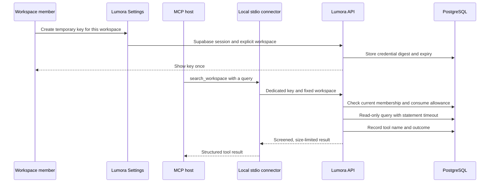
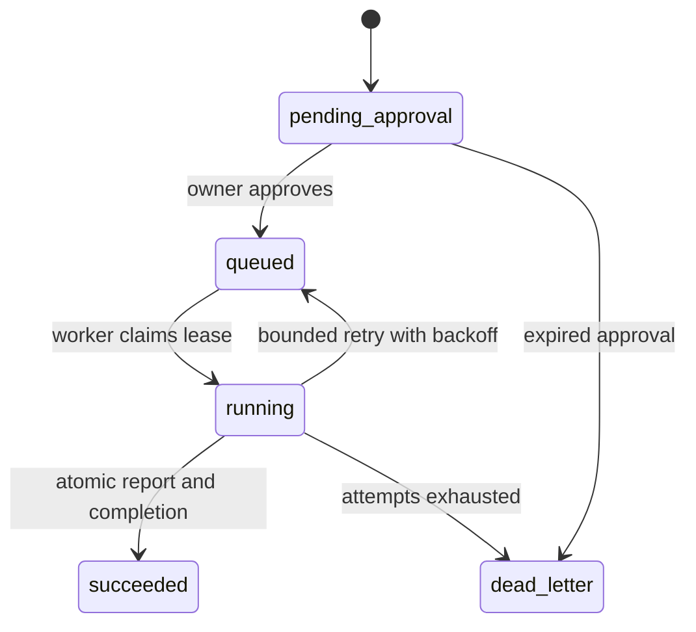

# Workspace MCP and approved actions

## Use Lumora from an assistant

Lumora's local MCP connector lets an assistant search one workspace and inspect
its sources. The assistant chooses a registered tool and supplies structured
arguments. The API verifies the credential, current workspace membership, role,
and call allowance before running a bounded query.



## Registered tools

| Tool | Input | Result | Role |
| --- | --- | --- | --- |
| `list_sources` | Optional `limit`, up to 10 | Indexed source metadata | Any member |
| `get_ingestion_status` | `jobId` | Status, progress, counts, timestamp | Any member |
| `get_quality_report` | Optional `limit`, up to 10 | Saved evaluation metrics | Owner |
| `get_document` | `documentId`, optional `limit` up to 5 | Metadata and screened excerpts | Any member |
| `search_workspace` | `query` up to 250 characters, optional `limit` up to 5 | Ranked keyword matches and excerpts | Any member |

Workspace selection belongs to the connection. Each HTTP call also sends the
workspace header, which must match the credential. Tool arguments cannot
override it. Unknown tools and unexpected argument fields are rejected.

Search uses PostgreSQL full-text search. These tools have a zero-provider
budget. They return small excerpts and metadata, with detected personal data
masked and medium/high-risk or unverified excerpts omitted. Excerpts remain
untrusted source material for the host's model.

## Build and start

Use Node 24. The API requires Supabase Auth and the existing workspace schema.
Apply migrations 023 and 024 through the normal migration command.

```sh
npm ci
npm run db:migrate
npm run mcp:build
```

Enable `MCP_ENABLED=true` on the API. The legacy global `API_KEY` mode is
incompatible with these session-authenticated management routes.

Sign in to Lumora and open **Workspace → Settings → Connect your assistant**.
Create a temporary key and copy the workspace ID displayed there. Creating a
new key rotates your earlier key for that workspace. The key is shown only in
the current browser view and is held in component memory.

In the terminal that will launch your MCP host, enter the key without placing
it in shell history.

```sh
export LUMORA_MCP_API_URL='https://rag-study-demo-api-4ae2.onrender.com'
export LUMORA_MCP_WORKSPACE_ID='YOUR-WORKSPACE-UUID'
printf 'Temporary MCP key: '
IFS= read -r -s LUMORA_MCP_TOKEN
printf '\n'
export LUMORA_MCP_TOKEN
```

For local API development, use `http://127.0.0.1:3000`. HTTPS is required for
other origins. The connector rejects credentials in URLs, redirects, origin
paths, fragments, and query strings.

The key expires after 15 minutes and allows 40 total calls, with 10 calls per
minute. Revocation takes effect on subsequent tool admission. The database
stores a SHA-256 digest, and every call checks current membership and role.
The assistant receives the private excerpts returned by its tools, so choose
the MCP host according to your workspace's data-handling policy.

## Connect Codex CLI

Add the following to your Codex configuration using your checkout's absolute
path. The example inherits credentials from the shell above. Start Codex CLI
from that shell. Desktop applications use their own configured environment.

```toml
[mcp_servers.lumora]
command = "/bin/sh"
args = ["/ABSOLUTE/PATH/TO/REPOSITORY/scripts/start-workspace-mcp.sh"]
env_vars = ["LUMORA_MCP_API_URL", "LUMORA_MCP_WORKSPACE_ID", "LUMORA_MCP_TOKEN"]
enabled_tools = ["list_sources", "search_workspace", "get_document", "get_ingestion_status", "get_quality_report"]
startup_timeout_sec = 15
tool_timeout_sec = 10
default_tools_approval_mode = "prompt"
```

Then start a new host session and ask it to use Lumora. The configuration
syntax and environment forwarding are described in the
[official MCP configuration guide](https://learn.chatgpt.com/docs/extend/mcp?surface=cli).
Keep the temporary key in the host's environment and out of configuration files.

## Practical legal-workspace example

Use a workspace containing your approved contract-handling materials. Ask the
connected assistant to find the termination-notice procedure and cite the
relevant passages.

```text
Use Lumora to find the termination-notice procedure.
Show which documents support the answer and quote only the returned excerpts.
Treat document text as reference material.
```

A possible sequence of tool calls is shown below. The document ID comes from a
returned result.

```json
{"name":"list_sources","arguments":{"limit":5}}
{"name":"search_workspace","arguments":{"query":"termination notice","limit":3}}
{"name":"get_document","arguments":{"documentId":"RETURNED-DOCUMENT-UUID","limit":2}}
```

The host uses those results to compose its response. Lumora enforces the
workspace boundary, tool names, schema, excerpt policy, and query limits. For
Portuguese materials, use Portuguese search terms such as `aviso rescisão`.
The first release uses keyword retrieval, so specific terms improve recall.

## Execution boundaries

The launcher starts a separate Node process with scoped reads of its modules
and contracts, with only its three connection variables in the environment.
It grants no filesystem writes, child-process execution,
worker-thread execution, native addons, WASI, or inspector access. Models
supply tool arguments and never supply executable code or filesystem paths.
The Node permission model provides constraints for this fixed connector code.
Use the container below for an additional operating-system boundary. Network
requests in the connector are confined to the configured API origin.

```sh
docker compose -f compose.mcp.yaml build lumora-mcp
docker compose -f compose.mcp.yaml run --rm --no-deps -T lumora-mcp
```

The container runs as a nonroot user with a read-only filesystem, dropped
capabilities, no host mounts, 128 MiB memory, 0.5 CPU, and 32 processes. It
contains the connector, contracts, and their runtime dependencies. It receives
only the three MCP environment variables.

Each bridge call has an eight-second deadline. Each API tool read has a
five-second deadline and bounded PostgreSQL statements. Cancellation closes the
connector's HTTP request and discards the checked-out database connection.
PostgreSQL's two-second statement timeout bounds cancellation through a pooler.
The structured data is capped at 16 KiB per result, with at most four concurrent
bridge calls. Credentials provide the total call budget.

The API uses a separate pool of two connections for these reads. Set
`MCP_READ_DATABASE_URL` to a dedicated SELECT-only PostgreSQL login when your
deployment has one. Repository reads additionally start an explicit read-only
transaction. Authentication counters and audit records use the API's write
connection. Tool audit records contain the tool name, outcome, actor, workspace,
and request ID. They exclude the query, excerpts, credential, and document body.

## Approved evaluation actions

`run_evaluation` has a separate approval and execution path. The concrete
handler runs a fixed four-case lexical retrieval and security evaluation. It
has a zero-provider budget and saves one evaluation result. The existing
dashboard's optional model-based evaluations keep their own execution path.



Enable `AGENT_ACTIONS_ENABLED=true` only when running the separate approved-action
worker. The worker requires `AGENT_ACTIONS_DATABASE_URL`, supplied by its
operator. Configure a database login with only the required action, evaluation,
and source-table privileges. Its process receives no LLM provider keys.

```sh
export AGENT_ACTIONS_DATABASE_URL='postgresql://YOUR-WORKER-CONNECTION'
npm run agent-actions:work
# To process at most one queued action
npm run agent-actions:work -- --once
```

For an operating-system boundary, build the existing API image for the
separate worker and launch it with a read-only root filesystem and explicit
resource limits.

```sh
docker compose -f compose.agent-actions.yaml build
docker compose -f compose.agent-actions.yaml up lumora-agent-actions
```

This starts continuous processing. The container receives only the worker
database connection.

An owner-authenticated API client requests an action with an idempotency key,
then explicitly approves it. `OWNER_ACCESS_TOKEN` is that client's normal
Supabase session token. A local MCP credential cannot approve these actions.

```sh
curl --fail-with-body "$LUMORA_MCP_API_URL/v1/agent-actions" \
  -H "Authorization: Bearer $OWNER_ACCESS_TOKEN" \
  -H "X-Workspace-Id: $LUMORA_MCP_WORKSPACE_ID" \
  -H 'Idempotency-Key: reviewed-evaluation-request-001' \
  -H 'Content-Type: application/json' \
  --data '{"action":"run_evaluation"}'

curl --fail-with-body "$LUMORA_MCP_API_URL/v1/agent-actions/RETURNED-ACTION-UUID/approve" \
  -H "Authorization: Bearer $OWNER_ACCESS_TOKEN" \
  -H "X-Workspace-Id: $LUMORA_MCP_WORKSPACE_ID" \
  -H 'Content-Type: application/json' \
  --data '{"approve":true}'
```

Read `GET /v1/agent-actions/RETURNED-ACTION-UUID` with the same owner session to
inspect the safe status and ordered reason-coded events. Approval expires after
24 hours. At most two actions can be approved per workspace in a rolling day.
Each attempt has a ten-second read deadline and a fifteen-second fenced lease.
Up to three attempts use exponential backoff. Permanent outcomes enter
`dead_letter`. Request, approval, worker claim, and result commit recheck
current owner membership. The report and completion event commit together.
Repeated requests with the same workspace, user, and idempotency key replay
the existing action. The worker stops reading when its shutdown signal is
aborted and fences stale attempts from committing results.

Future handlers that send messages, execute scripts, or modify documents need
their own isolation and effect-specific retry policy. This release's worker
registers only the fixed evaluation handler.

## Verification

Run the standard evaluation harness and UX suite. Dedicated tests cover
workspace isolation, read-only SQL, concurrent credential limits, expiry,
revocation, current RBAC, schema rejection, safe previews, cancellation, SDK
interoperability, and approval/lease/idempotency behaviour.

The MCP SDK transport and cancellation documentation is available in the
[official TypeScript SDK](https://ts.sdk.modelcontextprotocol.io/v2/).
The [Node permission documentation](https://nodejs.org/api/permissions.html)
explains the scope of Node's runtime constraints.
